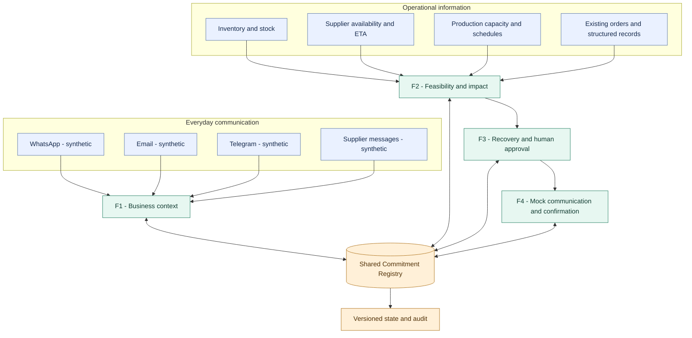
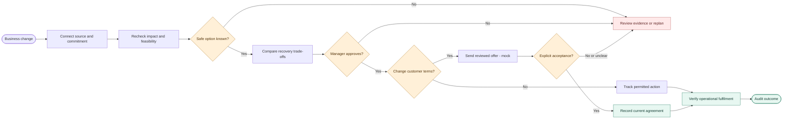

# PromiseFlow

### Protect the promise, even when the plan changes.

**SDC Hackathon 2026 · Domain 2 · Orbyte Smart SME Challenge · Alpha Red Solutions mentorship**

An SME can promise a customer a delivery in one conversation, discover a supplier delay in another, and keep the stock and production plan in a spreadsheet. **PromiseFlow connects those fragments around the customer commitment:** it identifies risk, compares realistic recovery choices, asks for human approval, and tracks customer agreement and actual delivery as separate outcomes.

> **Prototype, 23 October 2026:** F1–F4 APIs and screens exist, with synthetic data and selected passing tests. The complete browser → worker → database → approval → customer-response → outcome journey has **not** been independently verified. WhatsApp, Email, Telegram, outbound delivery and Orbyte connections are **synthetic, mock or proposed**, as detailed below.

The repository and application still use the engineering name **MouManTAI**. PromiseFlow is the product name for this presentation; API names have not been changed.

**Explore:** [Problem](#the-problem) · [Scenario](#one-sme-story) · [Capabilities](#four-connected-capabilities) · [AI](#selective-ai-ml-and-llm-architecture) · [Architecture](#system-architecture) · [Demo](#prototype-demo) · [Run locally](#run-locally) · [Status](#project-status-and-validation)

## The problem

Small businesses already work across disconnected tools:

- **Customer and supplier conversations:** WhatsApp, Email, Telegram and follow-up messages.
- **Operational records:** inventory, incoming supply, existing orders, production schedules and spreadsheets.
- **Human decisions:** an owner deciding whether to pay more, rearrange work or ask a customer to accept new terms.

When a supplier is late, a reminder alone does not answer **which promises are affected**, **which alternatives are feasible**, or **whether a revised promise was accepted and delivered**. The owner often has to reconcile all of this manually.

## Our solution

PromiseFlow is a **commitment-centered automation layer**. It is designed to:

1. Connect incoming business information to the right order, keeping its source and uncertainty.
2. Recheck stock, supplier timing and capacity when an operational fact changes.
3. Show affected promises and compare recovery choices against constraints.
4. Require authorized human approval for consequential action or changed customer terms.
5. Track communication, explicit customer response and operational fulfilment with separate evidence.

**Change → Impact → Action → Confirmation → Verified outcome** is the product story. The working prototype covers parts of this chain; the [status table](#project-status-and-validation) states the integration limits.

## One SME story

**A caterer promises 100 lunch boxes by 3 pm.** A packaging supplier later reports that 20 boxes will arrive after the production cutoff.

| Moment | Normal manual work | PromiseFlow's intended response |
|---|---|---|
| Customer request | Find the original chat and write down quantity and deadline. | Associate the message with a reviewable order context and a versioned commitment. |
| Supplier delay | Check stock and ask which orders need the same packaging. | Recalculate affected commitments against a fresh operational snapshot. |
| Recovery decision | Call another supplier or negotiate a new deadline. | Compare alternative supply with a revised delivery offer, including cost, assumptions and uncertainty. |
| Authorization | Decide verbally and follow up later. | Obtain a manager decision bound to the current plan and snapshot. |
| Customer and outcome | Send a message, interpret the reply, check delivery separately. | Track a mock outbound message, exact proposal response, operational action and fulfilment evidence as different states. |

**In today's demo**, `/recovery/demo` is a **read-only synthetic** supplier-delay walkthrough. It shows the two trade-offs but does not approve a plan, buy packaging, contact a real customer or prove delivery. The persisted seed records and APIs are separate evidence, not a replay of this entire story.

## Four connected capabilities

| Capability | Business value | Current prototype |
|---|---|---|
| **F1 · Business Context Intelligence** | Understand customer and supplier messages, preserving source evidence and unresolved fields. | Synthetic inbox, message processing and order-context review routes. The UI can compose **mock WhatsApp, Email and Telegram envelopes**; official provider webhooks are not connected. |
| **F2 · Commitment Feasibility & Impact** | Check materials, timing and affected promises when conditions change. | Deterministic evaluation, impact code and pages. Supplier-event mutation and key worker subscriptions are gated to isolated E2E mode. |
| **F3 · Intelligent Recovery & Change-to-Action** | Compare constrained options, ask for approval and track permitted action. | Case, plan, approval and action code/pages. Normal actor authority fails closed; isolated mode requires a server-owned key. Current action is a synthetic internal review task, not procurement. |
| **F4 · Closed-Loop Communication & Confirmation** | Prepare a changed offer, track delivery and resolve an explicit reply. | Communication, confirmation and follow-up code/pages with a local mock provider. A sent message is not acceptance; acceptance is not fulfilment. |

The **Shared Commitment Registry (P5)** is the backbone of these four capabilities, **not a fifth feature**. It holds one tenant/commitment identity, versioned terms, distinct agreement/feasibility/risk/recovery/fulfilment states, audit records and outbox events.

## What makes PromiseFlow different

- **Commitment-centered:** follow a specific customer promise instead of treating every chat as an isolated task.
- **Change to impact:** re-evaluate affected orders rather than merely announce a supplier delay.
- **Constrained recovery:** expose whether an option is feasible, conditional or unknown, with cost and customer impact.
- **Governed action:** approval binds the current plan and versions; stale or missing authority blocks action.
- **Closed-loop evidence:** `REQUESTED ≠ CONFIRMED`, `APPROVED ≠ EXECUTED`, and `SENT ≠ ACCEPTED ≠ FULFILLED`.

This design can complement spreadsheets, order systems or an ERP; it does not replace every business system. These are product design distinctions, **not measured superiority claims**.

## Selective AI, ML and LLM architecture

**Use the cheapest reliable layer first.** AI assists with interpreting messy language; it does not calculate stock, grant authority or certify fulfilment.

| Layer | Technology / model | Business task | Why this choice | Integration status |
|---|---|---|---|---|
| **L0 · Rules** | Deterministic Python rules and validated business records | Known references, quantities/dates, stock and capacity checks, plan constraints, version and approval policy | Reproducible decisions and inspectable reasons | **Implemented** in context, feasibility, recovery and Core. Offline demo works without a model endpoint. |
| **L1 · Entity extraction** | [GLiNER `urchade/gliner_multi-v2.1`](https://huggingface.co/urchade/gliner_multi-v2.1) | Propose product, quantity, delivery and reference spans from multilingual messages | Flexible entity labels with original text spans | **Implemented as an opt-in remote inference stage** with a pinned model revision and tests. A saved evaluation artifact exists; not required for the standard offline demo. |
| **L1 · Documents** | PyMuPDF text extraction; optional PaddleOCR | Read supported PDF text and scanned/image attachments while retaining evidence | Use document parsing first; OCR when needed | **Implemented in P1 code and scoped tests.** OCR dependencies/runtime must be available; it is not proof of payment. |
| **L1 · Intent candidate** | [XLM-RoBERTa `FacebookAI/xlm-roberta-base`](https://huggingface.co/FacebookAI/xlm-roberta-base) | Possible future multilingual intent classification | Multilingual encoder suitable for **fine-tuning** | **Candidate only.** The base encoder is not a trained SME intent classifier; no fine-tuned classifier is integrated. |
| **L2 · Selective interpretation** | [Qwen `Qwen/Qwen3-4B-Instruct-2507`](https://huggingface.co/Qwen/Qwen3-4B-Instruct-2507) | Propose interpretation of genuinely ambiguous message details | Instruction-following model with multilingual potential | **Optional integrated adapter/worker path**, not default offline inference. GPU worker and RunPod transport code exist; a saved 26-case synthetic evaluation reports sample remote runs. No live endpoint, ongoing availability or pilot accuracy was reverified for this README. |

The P1 protocol pins model IDs and revisions in `backend/app/context/ai/protocol.py`. A [saved 26-case evaluation](backend/app/context/experiments/ai_gpu/unseen_acceptance_results.json) contains results and self-reported GPU telemetry; it is a limited synthetic test, not general SME accuracy or proof that an endpoint is currently available. GLiNER has also been kept optional after earlier domain-specific evaluation gaps.

**Safety path:** bounded inputs → structured model output → schema and quote/span validation → product and business-rule checks → visible uncertainty or manual review. Failed or unavailable inference falls back to deterministic processing or an unresolved state. Recovery feasibility, arithmetic, approval and fulfilment remain rule/evidence decisions. Open model weights offer deployment choice, cost visibility and multilingual potential, but hosted GPU use can cost money and sending data to a remote endpoint requires privacy controls; the models are not assumed free, private or local.

## System architecture

The first diagram shows **business sources and module responsibilities**, including simulated communication channels and operational records. Arrows describe intended information flow; they do not imply live provider connectors.



**Approval and outcome flow:**



This second diagram is the **target business journey**. The prototype has working pieces and selected integration tests, but an uninterrupted live end-to-end run has not been verified on current main.

## Technology at a glance

| Area | Verified repository choice |
|---|---|
| Frontend | React 19, TypeScript, Vite, React Router, TanStack Query; Vitest and Testing Library |
| Backend | FastAPI, Pydantic, SQLAlchemy; modular F1–F4 and Core routes |
| Data and events | PostgreSQL configuration, Alembic migrations, versioned Commitment Registry, database outbox and worker |
| AI and documents | Deterministic extraction; optional GLiNER/Qwen remote worker path; PyMuPDF and PaddleOCR code |
| Local development | Docker Compose, synthetic seed fixtures, Pytest, GitHub Actions workflow |

## Prototype demo

No screenshots are committed in this repository, so this README uses reproducible routes and diagrams rather than an invented product image.

1. Start the database/API and frontend using [Run locally](#run-locally). Confirm `/health` returns `status: ok`.
2. Open `/inbox`. The **Synthetic Composer** offers WhatsApp, Email and Telegram examples. Submitting one creates a mock inbound envelope, **not** a real provider message. Review extracted fields, source evidence and unresolved items.
3. Open `/overview` and `/commitments/com_delay_01` to inspect seeded commitments and any available feasibility data. Seeded risk state is a starting fixture, not proof that a supplier event just ran.
4. Open `/recovery/demo` to compare a conditional alternative supplier with a revised deadline. “Discuss this trade-off” is display-only and records no approval or action.
5. Open `/activity` or request `GET /v1/commitments/com_delay_01/timeline` with `X-Tenant-ID: tenant_demo_01` and `X-Actor-ID: user_owner_01` to inspect persisted state and audit evidence.

**Not part of this reproducible walkthrough:** live supplier ingestion, real manager approval, external purchase, live outbound send, explicit customer response and actual delivery under one fresh event chain. Those require a separately recorded isolated E2E run. A customer accepting revised terms would still not prove the goods were delivered.

## Business impact and SDGs

**Expected, not measured:** less manual coordination, faster identification of threatened promises, fewer missed follow-ups, more consistent recovery decisions and better accountability. Better planning could also reduce avoidable rework or material waste; this has not been measured.

- **SDG 8 · Decent Work and Economic Growth:** help SMEs manage orders and staff time more reliably.
- **SDG 9 · Industry, Innovation and Infrastructure:** connect fragmented operational information with a reusable decision workflow.
- **Pilot measurement:** record baseline and sample size, then compare time to find affected commitments, time to an approved response, overlooked commitments, duplicate contacts and cases with complete outcome evidence.

## Orbyte ecosystem fit

PromiseFlow could be a reusable commitment-assurance capability in a connected SME business hub:

- **Read** customer requests, inventory, supplier changes and permission context through agreed adapters.
- **Write back** risk, approval, communication and audit events with stable IDs and versions.
- **Configure** products, cutoff times, channels and approval policies per business.

**There is no official Orbyte API, sandbox or production connection available to this project.** These are conceptual integration boundaries, not tested Orbyte compatibility. Production use also needs authenticated tenants, consent and real connector contracts.

## Run locally

**Prerequisites:** Docker Desktop with a Linux engine, Python 3.11–3.14 for local backend work, Node.js 20+ and npm. Default ports: PostgreSQL `5433`, API `8000`, Vite `5173`. Use a disposable synthetic database.

```powershell
# From repository root. Edit .env with a local PostgreSQL password first.
Copy-Item .env.example .env
$env:P1_AI_ENABLED = 'false' # offline deterministic demo; overrides .env for Compose
docker compose up --build
Invoke-RestMethod http://localhost:8000/health
```

Compose migrates PostgreSQL and runs `scripts/seed_demo.py` before starting the API; it also starts the outbox worker. The seed resets its five named synthetic commitments, so point it only at an intended demo database. `.env.example` contains placeholder remote GPU settings; they are **not** a working inference connection.

In a second terminal:

```powershell
Set-Location frontend
npm.cmd ci
npm.cmd run dev
```

Open `http://localhost:5173/overview`. The frontend defaults to API `http://localhost:8000`; set `VITE_API_BASE_URL` before Vite starts if the API differs. To launch a separate local backend against the same database:

```powershell
python -m venv backend/.venv
backend/.venv/Scripts/python.exe -m pip install -e './backend[dev]'
$env:DATABASE_URL = 'postgresql+psycopg://moumantai:<local-password>@localhost:5433/moumantai'
$env:P1_AI_ENABLED = 'false'
backend/.venv/Scripts/python.exe -m alembic -c backend/alembic.ini upgrade head
backend/.venv/Scripts/python.exe scripts/seed_demo.py
backend/.venv/Scripts/python.exe -m uvicorn app.main:app --app-dir backend --reload --port 8000
```

Use the same `DATABASE_URL` for migration, seed and API. For tests, run `python -m pytest backend/tests -q` from the root; in `frontend`, run `npm.cmd run typecheck`, `npm.cmd test`, and `npm.cmd run build`. PostgreSQL-gated tests require an approved disposable test database. A skipped test does not verify that path. If `tsc` is missing, run `npm.cmd ci`. A `503` on an authority-dependent route may be the intended fail-closed response outside isolated mode.

## Project status and validation

The status below reflects repository evidence at the 23 October 2026 audit and the current main code, not a claimed production deployment.

| Area | Status | Evidence / limit |
|---|---|---|
| Backend and Core | **Implemented; selected tests verified** | F1–F4/Core FastAPI routes, registry, version checks, audit and outbox. `backend/tests/integration/test_feature_handshakes.py`: **19 passed, 1 PostgreSQL-gated skip** in the documentation audit. |
| Frontend | **Implemented; component tests verified** | Feature routes exist. After `npm ci`, typecheck and build passed; Vitest reported **475 passed, 5 skipped**. No live browser/API chain was run in that audit. |
| Channel ingestion | **Synthetic / mock** | The UI sends mock WhatsApp/Email/Telegram envelopes to P1. No official channel webhooks or accounts. |
| AI | **Optional, partly validated** | Deterministic path is implemented; GLiNER/Qwen adapters and a saved 26-case synthetic evaluation exist. No currently available GPU endpoint or general SME accuracy is established by this README. |
| Recovery and outbound | **Partial / isolated** | Synthetic comparison, versioned approval code and mock communication exist. Normal authority gates fail closed; no real purchase or customer send. |
| Full cross-feature journey | **Not verified end to end** | Selected tests cover boundaries, but one persisted browser/worker/DB/approval/customer-response/outcome run is still needed. |
| Orbyte | **Concept only** | No official API or sandbox connection. |

**Security boundary:** demo actor IDs are selected through headers and do not provide production authentication. Consequential actions require current server-side approval and version checks; synthetic fixtures must not contain real customer data or trigger real payments or messaging.

## Roadmap

1. **Before submission:** record one same-commitment synthetic journey with event IDs, before/after states, approval scope, customer response, audit and an unsafe/ambiguous case.
2. **Pilot:** validate the problem and usability with an SME; measure manual baseline against the prototype.
3. **Production work:** official messaging and business-system connectors, authenticated tenant membership, consent, monitoring, PostgreSQL migration/concurrency evidence and stronger multilingual model evaluation.
4. **Later research:** prediction or advanced scheduling only where measured operational data justifies it.

## Team and acknowledgements

- **P1:** context intelligence and inbox · **P2:** feasibility and impact · **P3:** recovery · **P4:** communication and confirmation · **P5:** registry, shared contracts and integration.
- [System requirements](docs/REQUIREMENTS_SYSTEM.md) · [Team log](docs/TEAM_LOG.md) · [Mentorship preparation](docs/MENTORSHIP_PREP.md) · [Repository instructions](AGENTS.md).
- Prepared for the **SDC Hackathon 2026 Domain 2** challenge and **Alpha Red Solutions** mentorship in the Orbyte Smart SME context. Product claims above are limited to repository and test evidence.
