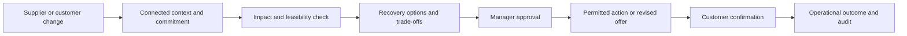

# PromiseFlow — Intelligent Commitment Assurance & Recovery for SMEs

**The problem.** SMEs struggle to keep customer delivery promises when order messages, inventory, suppliers and production information are disconnected. When something changes, an owner must work out which promises are at risk, what can still be delivered and whom to contact.

**The solution.** PromiseFlow connects this information around each customer commitment. It checks feasibility, detects changes that threaten a promise, compares recovery options, and coordinates authorized action and customer confirmation.

**The distinction.** We focus on protecting customer commitments from the moment they are made through operational change, recovery decisions and evidenced outcomes. This is neither another chatbot nor a full ERP. The repository and application currently use the development name **MouManTAI**; PromiseFlow is the name used for this mentorship presentation. No code or API has been renamed.

> **Status, 23 October 2026:** a synthetic, database-backed prototype has F1–F4 routes and screens. Separate components and selected cross-feature tests work. A single browser-to-worker-to-database journey covering trigger, approved recovery, customer response and outcome has **not** been independently verified on this main snapshot. Consequential authority is limited to explicitly keyed isolated demo mode. There is no live Orbyte or customer-channel connection.

## 1. Project overview

The intended users are SME owners, operations managers and staff who must keep delivery promises despite changes to supplies, stock or capacity. Missing a change can mean an avoidable late delivery, repeated manual calls and disagreement over what was agreed. These are expected business problems, not measured outcomes of this prototype.

## 2. A realistic SME scenario

A caterer promises **100 lunch boxes by 3 pm tomorrow**. The packaging supplier then moves a delivery past the production cutoff. Today, the owner might search messages and spreadsheets, call suppliers, check stock, recalculate the order, choose between alternative packaging or asking for more time, and record the reply manually.

In the intended journey, the supplier update triggers a fresh feasibility check for affected commitments. The owner sees the shortage and two options with assumptions, cost and customer impact. A manager authorizes consequential action. A proposed deadline goes to the customer only after review. The response is tied to the precise proposal version; actual packing and delivery still require separate operational evidence.

**What can be shown today:** `/recovery/demo` is a read-only synthetic supplier-delay walkthrough. It compares two strategies while explicitly leaving availability, approval and outcome unproved. Seeded API records show commitment states and audit history. The full caterer journey remains an integration target; selecting a discussion option does not approve or execute it.

## 3. Four connected capabilities

| Capability | Business job | Present boundary |
|---|---|---|
| **F1 — Business Context Intelligence (P1)** | Turn incoming customer or supplier information into reviewable order context, retaining source and uncertainty. | Synthetic message ingestion, extraction, review and inbox/order routes exist. Latest main includes optional remote GPU inference configuration and a 26-case evaluation artifact; no live customer channel or independent pilot validation is established here. |
| **F2 — Commitment Feasibility & Impact (P2)** | Check materials and timing, then identify commitments affected by change. | Deterministic assessment/impact code, API and pages exist. Supplier-event mutation routes require isolated E2E mode; normal worker registration is gated. |
| **F3 — Intelligent Recovery & Change-to-Action (P3)** | Compare constrained choices, show trade-offs, request authorization and track permitted action. | Case, plan, approval and action APIs/pages exist. Approval needs trusted isolated actor mode. Current action creates a **synthetic internal review task**, not a purchase or supplier booking. |
| **F4 — Closed-Loop Communication & Confirmation (P4)** | Prepare an approved message, track mock sending and resolve an explicit customer reply. | Communication, confirmation and follow-up routes/pages are mounted. The provider is mock; affirmative authority is for isolated synthetic runtime, not a real channel. |

The **Shared Commitment Registry (P5)** is the common backbone, not a fifth feature. It keeps tenant and commitment identity, versioned terms, separate agreement/feasibility/risk/recovery/fulfilment states, audit records and outbox events. A request is not yet a confirmed promise; a feasible snapshot is not a delivery guarantee; approval is not execution; and `SENT`, `ACCEPTED` and `FULFILLED` are different facts.

## 4. One complete automated journey — target and present evidence



This is the **target** journey. The repository has pieces of every stage and selected service/API integration tests. The normal worker leaves some mandatory subscribers unregistered; isolated mode registers the F2 confirmed-commitment evaluator and F3 risk trigger. P3 response handoff and real-world action remain restricted. An accepted revised offer can update agreement, but only separate trusted operational evidence can mark fulfilment.

## 5. Innovation and differentiation

| Existing approach | PromiseFlow design goal |
|---|---|
| Spreadsheet or manual calls | One versioned commitment and a trace of change, affected promise and decision. |
| Reminder tool | Recalculate impact and propose a next action, beyond alerting that a date is near. |
| Generic AI chat | Constrain suggestions with stock, timing, identity, approval and evidence checks. |
| Order dashboard or ERP | Focus on the lifecycle of the *promise* and recovery across systems, rather than replacing every operational system. |

The design uses change → impact → action, human control of consequential choices, and separate evidence for agreement and fulfilment. These are design distinctions, not proven superiority claims. Reusable adapters and policies could let the lifecycle serve catering, small manufacturing or other delivery-based SMEs once their data is available.

## 6. Orbyte ecosystem fit

Conceptually, a connected business hub could provide customer requests, inventory snapshots, supplier updates and approval identities. PromiseFlow would consume those through versioned adapters and publish risk, decision, action and audit events back to the hub. Each SME would map its products, units, cutoff times, approval roles and channels to the common workflow.

**No official Orbyte API, sandbox or production connection is available.** The repository's event, inventory, contact and channel interfaces are internal or simulated. This is a proposed integration boundary, not an integration claim.

## 7. Current MVP implementation status

This table applies to the synchronized `origin/main` snapshot at `b078755` on 23 October 2026, not every parallel worktree. Requirements and historical log entries are not proof of current runtime success.

| Area | Status | Evidence and limit |
|---|---|---|
| Shared backend | **Implemented and verified in selected tests** | FastAPI mounts Core, F1, F2 reads, F3 and F4; SQLAlchemy/Alembic, registry, audit and outbox exist. `backend/tests/integration/test_feature_handshakes.py` passed **19, skipped 1** in this audit; PostgreSQL case skipped. |
| Frontend | **Implemented and verified in component tests; live integration not verified here** | React/TypeScript routes exist for inbox, order, commitment, impact, recovery, communication, confirmation, overview and activity. After `npm ci`, typecheck and build passed; Vitest reported **475 passed, 5 skipped**. No live browser/API journey was run. |
| Synthetic examples | **Mock / synthetic** | `scripts/seed_demo.py` provides five synthetic commitments. `/recovery/demo` is a read-only fixture; outbound uses a local mock provider. Seed state is not a replay of one full event journey. |
| F1 → F2 → F3 → F4 orchestration | **Partially implemented** | Tests cover several boundaries. Normal worker F2/F3 subscriber registration is gated by `MOUMANTAI_ISOLATED_E2E`; one live UI/API journey was not observed here. |
| Consequential approval and action | **Partially implemented / blocked outside isolated mode** | Versioned manager approval records and guards exist. Normal F3 actor provider fails closed; isolated mode requires a server-owned key. Action is synthetic internal review. |
| Customer communication and outcome | **Implemented with mock transport; integration incomplete** | F4 stores draft/review/mock send and confirmation evidence. No real sender, delivery proof or production identity provider is connected. |
| Orbyte and production integrations | **Planned / not implemented** | No official Orbyte contract or live connection, production channel or externally verified business metrics. |

`docs/TEAM_LOG.md` includes earlier claims of 12 E2E acceptance scenarios and later records of blocked live integration. Those scenarios are service/TestClient checks with fixtures; they do not establish a current browser-to-real-worker PostgreSQL demo. Recent log notes also predate some merges, so this table prioritizes mounted code and the audit's tests.

## 8. Reproducible demo using current synthetic fixtures

This safe walkthrough is **read-only** and does not imply that the whole flow has executed. Use synthetic data only.

1. From the repository root run `docker compose up --build`. Compose migrates PostgreSQL, runs `scripts/seed_demo.py`, then starts the API and worker. Confirm `http://localhost:8000/health` returns `status: ok`. If Docker is unavailable, the database-backed demo is unavailable.
2. In a second terminal run `cd frontend`, `npm ci`, `npm run dev`. Open `http://localhost:5173/overview` with default synthetic tenant `tenant_demo_01` and Owner actor. The overview should show seeded commitments. Counts are seeded state, not evidence that a supplier event just ran.
3. Open `/commitments/com_delay_01` for available feasibility information, then `/recovery/demo` to discuss the packaging delay. Click “Discuss this trade-off”; the screen says no approval or action was recorded.
4. For persisted evidence, request `GET http://localhost:8000/v1/commitments/com_delay_01/timeline` with headers `X-Tenant-ID: tenant_demo_01` and `X-Actor-ID: user_owner_01`, or inspect `/activity`. Compare agreement, risk and fulfilment independently. A seeded at-risk state is not evidence of a freshly executed trigger.
5. Explain the **planned continuation** verbally: generate plans from a fresh authoritative assessment, manager approval, synthetic task or revised offer, mock send, explicit customer response, then separate fulfilment proof. These steps are **not** part of this walkthrough. Do not describe them as observed without a new E2E run and audit IDs.

Isolated E2E mutation mode requires a private server-owned key and controlled database. See the relevant tests and `docs/TEAM_LOG.md` before using it; never expose the key in shared documentation.

## 9. Technology and architecture

The codebase is a modular FastAPI backend with Pydantic, SQLAlchemy, Alembic and PostgreSQL configuration; React 19, TypeScript and Vite frontend; DB outbox worker; Pytest and Vitest tests; and Docker Compose. One registry owns authoritative commitment transitions. Version checks, audit references and tenant scopes connect the modules.

Decision logic is **rules first**: known stock, timing, versions and policy determine feasibility and authorization. F1 includes optional extraction/OCR and remote GPU inference paths. Latest main contains a 26-case evaluation artifact for that path, but this audit did not reproduce its remote inference run or establish field performance in an SME pilot. Offline setup uses deterministic rules.

## 10. Installation and local setup

Prerequisites: Docker Desktop with a running Linux engine for the database path; Python 3.11–3.14 for local backend work; Node.js 20+ and npm. Use a disposable synthetic database. Default ports: PostgreSQL **5433**, API **8000**, Vite **5173**.

```powershell
# Repository root: inspect .env.example and set a local PostgreSQL password in .env.
Copy-Item .env.example .env
# For an offline synthetic demo, set P1_AI_ENABLED=false in .env before Compose.
docker compose up --build
Invoke-RestMethod http://localhost:8000/health
```

The current `.env.example` sets `P1_AI_ENABLED=true` and contains placeholder remote endpoint/key values. Set it to `false` for this offline demo; do not treat placeholders as a working inference connection. Compose supplies its container `DATABASE_URL`, runs `alembic upgrade head`, then seeds data. For a separately launched local backend, set `DATABASE_URL` to the intended database, install dependencies, migrate and seed explicitly:

```powershell
python -m venv backend/.venv
backend/.venv/Scripts/python.exe -m pip install -e './backend[dev]'
$env:DATABASE_URL = 'postgresql+psycopg://moumantai:<local-password>@localhost:5433/moumantai'
$env:P1_AI_ENABLED = 'false'
backend/.venv/Scripts/python.exe -m alembic -c backend/alembic.ini upgrade head
backend/.venv/Scripts/python.exe scripts/seed_demo.py
backend/.venv/Scripts/python.exe -m uvicorn app.main:app --app-dir backend --reload --port 8000
```

Use the **same** database URL for migration, seed and server. The seed resets its five named synthetic commitments; run it only against an intended demo database. In a second terminal:

```powershell
Set-Location frontend
npm.cmd ci
npm.cmd run dev
```

`VITE_API_BASE_URL` defaults to `http://localhost:8000` in the shared client. Set it before starting Vite if the API uses another address. From the root run `python -m pytest backend/tests -q`; from `frontend` run `npm.cmd run typecheck`, `npm.cmd test`, and `npm.cmd run build`. PostgreSQL-gated tests need their documented disposable test database variables; skipped tests do not prove that path. If `tsc` is missing, run `npm.cmd ci` in `frontend`. If Docker cannot connect, start Docker Desktop's Linux engine. If an API action returns 503, inspect its response and runtime capabilities; authority-dependent operations intentionally fail closed in normal mode.

## 11. Security and human control

Records and queries carry tenant identity, and server-side handlers check roles, versions and evidence for protected transitions. Recovery approval binds a manager, plan/proposal and snapshot versions; changed or expired authorization cannot be reused. Audit and outbox records preserve the trail. The demonstration uses generated synthetic records and a local mock sender. **Prototype limit:** standard request context maps demo actor IDs from headers; this is not production authentication. Do not put real customer data, payments or public outbound messaging through this setup.

## 12. Business impact and validation

Expected benefits are less manual coordination, faster impact assessment, fewer overlooked commitments, more consistent recovery decisions and clearer accountability. None is a measured customer outcome here. In a pilot, compare time from supplier change to affected-order identification, time to approved recovery, proportion of at-risk promises found before deadline, duplicate/manual contacts, and cases with complete agreement and fulfilment evidence. Record baseline, sample size and exceptions before claiming improvement.

## 13. Scalability, adoption and business model

The lifecycle could be reused across SMEs by configuring products, stock sources, deadlines, approval limits and channels. A narrow adoption path is one operational workflow and one synthetic-to-real connector pilot, followed by usability observation and measured value. Possible pricing is a small monthly subscription with usage tiers for connected channels or processed commitments; pricing has **not** been validated. Production requires official integration contracts, authenticated tenant membership, consent and channel permissions, monitoring, PostgreSQL concurrency and migration evidence, data protection and pilot validation.

## 14. Team contributions, limitations and roadmap

P1 owns context/inbox; P2 feasibility/impact; P3 recovery; P4 communication/confirmation; P5 registry, shared contracts, routing, outbox and integration. See [AGENTS.md](AGENTS.md), [requirements baseline](docs/REQUIREMENTS_SYSTEM.md), [team log](docs/TEAM_LOG.md) and [mentorship preparation](docs/MENTORSHIP_PREP.md). Requirements assign work; current code and tests determine the status above.

Before 25 October, prioritize one recorded, reproducible end-to-end synthetic workflow on an approved disposable database, including failure and audit evidence. Then check usability and explain partial states. Official Orbyte and live channel connections, production auth and broader SME pilots are later work. Shared documentation should be reviewed by P5/release owner before submission.
