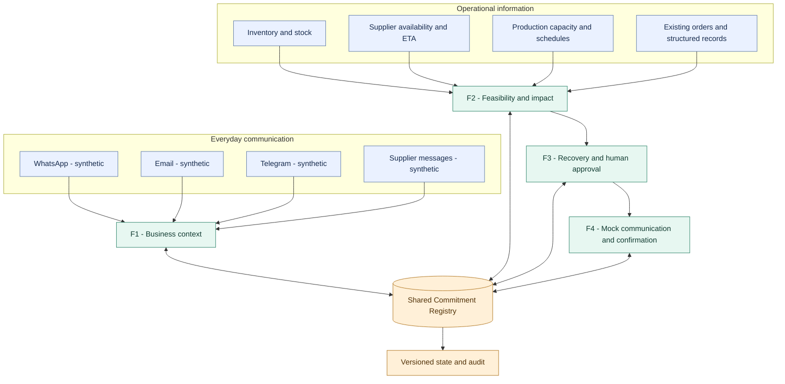
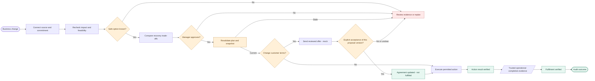

# MouManTAI

### Protect the promise, even when the plan changes.

**SDC Hackathon 2026 · Domain 2 · Orbyte Smart SME Challenge · Alpha Red Solutions**

MouManTAI turns fragmented business communication into **actionable customer-commitment recovery**. From a WhatsApp order to a supplier delay, then stock and capacity checks, recovery options and human approval, it helps SMEs protect what they promised customers, without replacing the spreadsheets, chats and systems they already use.

An SME may promise delivery in a chat, hear about a supplier delay elsewhere, and track stock in a spreadsheet. **MouManTAI identifies affected commitments**, compares recovery choices, requests authorized approval, and tracks customer agreement separately from actual delivery.

> **Prototype note (23 Oct 2026):** F1–F4 APIs and screens run on **synthetic data**. WhatsApp, Email, Telegram, outbound messages and Orbyte connections are simulated or proposed. See [Project status](#project-status-and-validation) for exactly what has and has not been verified.
>
> Code identifiers (database, package, API names) use the lowercase form `moumantai`.

**Explore:** [Problem](#the-problem) · [Story](#one-sme-story) · [Capabilities](#four-connected-capabilities) · [Why different](#why-moumantai-is-different) · [Control](#people-stay-in-control) · [AI](#selective-ai-ml-and-llm-architecture) · [Architecture](#system-architecture) · [Demo](#prototype-demo) · [Market](#first-market-and-business-model-hypotheses) · [Privacy](#privacy-and-pdpa-in-a-real-deployment) · [Risks](#hardest-risks-and-fallbacks) · [Run](#run-locally) · [Status](#project-status-and-validation)

## The problem

Small businesses already work across disconnected tools:

- **Conversations:** customers and suppliers on WhatsApp, Email and Telegram.
- **Operational records:** inventory, incoming supply, existing orders, production schedules, spreadsheets.
- **Human decisions:** an owner deciding whether to pay more, rearrange work, or ask a customer to accept new terms.

When a supplier is late, a reminder does not answer **which promises are affected**, **which alternatives are feasible**, or **whether the customer accepted a revised promise and it was actually delivered**. The owner reconciles all of this by hand, often in the evening.

## Our solution

MouManTAI is a **commitment-centered automation layer** that:

1. Connects incoming business information to the right order, keeping its source and uncertainty.
2. Rechecks stock, supplier timing and capacity when an operational fact changes.
3. Shows affected promises and compares recovery options against hard constraints.
4. Requires authorized human approval for consequential action or changed customer terms.
5. Tracks communication, explicit customer response and operational fulfilment with separate evidence.

**Change → Impact → Action → Confirmation → Verified outcome.**

## One SME story

**A caterer promises 100 lunch boxes by 3 pm.** A packaging supplier later reports that 20 boxes will arrive after the production cutoff.

| Moment | Normal manual work | MouManTAI's intended response |
|---|---|---|
| Customer request | Find the original chat, write down quantity and deadline. | Link the message to a reviewable order context and a versioned commitment. |
| Supplier delay | Check stock; work out which other orders use the same packaging. | Recalculate only the commitments truly affected, against a fresh operational snapshot. |
| Recovery decision | Phone another supplier or negotiate a new deadline. | Compare alternative supply with a revised delivery offer, showing cost, assumptions and uncertainty. |
| Authorization | Decide verbally, follow up later. | Manager decision bound to the current plan and snapshot version. |
| Customer and outcome | Send a message, interpret the reply, check delivery separately. | Track the message, the exact proposal response, the operational action and fulfilment evidence as different states. |

**In today's demo**, `/recovery/demo` is a **read-only synthetic walkthrough** of this supplier-delay trade-off. It does not approve a plan, buy packaging, contact a customer or prove delivery. Persisted seed records and APIs are separate evidence, not a replay of the whole story.

## Four connected capabilities

| Capability | Business value | Current prototype |
|---|---|---|
| **F1 · Business Context Intelligence** | Understand customer and supplier messages while preserving source evidence and unresolved fields. | Synthetic inbox, message processing, order-context review. UI composes **mock WhatsApp, Email and Telegram envelopes**; no official provider webhooks. |
| **F2 · Commitment Feasibility & Impact** | Check materials, timing and affected promises when conditions change. | Deterministic evaluation, impact code and pages. Supplier-event mutation and key worker subscriptions are gated to isolated E2E mode. |
| **F3 · Intelligent Recovery & Change-to-Action** | Compare constrained options, ask for approval, track permitted action. | Case, plan, approval and action code/pages. Normal actor authority fails closed; isolated mode needs a server-owned key. Current action is a synthetic internal review task, not procurement. |
| **F4 · Closed-Loop Communication & Confirmation** | Prepare a changed offer, track delivery, resolve an explicit reply. | Communication, confirmation and follow-up code/pages with a local mock provider. |

The **Shared Commitment Registry (P5)** is the backbone, **not a fifth feature**: one tenant/commitment identity, versioned terms, separate agreement / feasibility / risk / recovery / fulfilment states, audit records and outbox events.

## Why MouManTAI is different

A fair question is: *isn't this just an order system plus AI?* The table compares **design intent**, not measured superiority over any product.

| Capability | Typical tools (chat apps, spreadsheets, basic order tools) | MouManTAI design goal |
|---|---|---|
| Understand messages | Messages stay in separate channels; staff re-type details. | Extract fields across channels with source spans, uncertainty and manual review. |
| Supplier delay | Someone is notified and must work out the effect. | Re-evaluate commitments and flag only those actually affected. |
| Recovery | Owner searches for a fix manually. | Options validated by the same feasibility engine, with cost, delay and risk side by side. |
| Decision | Verbal or scattered approvals. | Approval bound to actor, role, plan version and snapshot version; stale approvals are blocked. |
| Outcome | Order status only. | Message state, customer acceptance, action result and fulfilment evidence tracked separately. |

Core rules: `REQUESTED ≠ CONFIRMED`, `APPROVED ≠ EXECUTED`, `SENT ≠ ACCEPTED ≠ FULFILLED`, supplier promise ≠ goods received, receipt image ≠ verified payment. MouManTAI can complement spreadsheets, order systems or an ERP; it does not replace them.

## People stay in control

Login and roles are **simulated** (as the challenge allows). Demo actors are chosen through request headers; this is **not** production authentication. The intended policy:

| Role (synthetic) | Can view | Can act |
|---|---|---|
| **Owner** | All commitments, recovery cases, audit. | Approve consequential recovery and changed customer terms; configure approval limits. |
| **Manager** | Commitments, recovery cases, communications, audit. | Approve or reject recovery plans within policy; approve sending customer offers. |
| **Staff** | Inbox, order contexts, commitment status. | Review and correct extracted fields, request more information, prepare drafts. Cannot approve procurement or promise changes. |

Enforced on the server (not only hidden in the UI): tenant scoping, role checks, approval tied to plan/snapshot version and expiry, and an audit record of who did what and when. Every consequential state change writes to the activity log (`/activity`).

**Easy to learn:** the journey follows the questions an owner already asks: *What changed? → Which promises are affected? → What can I do? → Do I approve? → Did the customer agree? → Was it delivered?* Statuses use plain, distinct labels (`UNKNOWN`, `PENDING_APPROVAL`, `INVALIDATED`, `FULFILLED`), and pending states never show a success colour. Usability without training is a **design goal that still needs testing with real users** (see [Roadmap](#roadmap)).

## Selective AI, ML and LLM architecture

**Use the cheapest reliable layer first.** AI helps interpret messy language; it does not calculate stock, grant authority or certify fulfilment.

| Layer | Technology / model | Business task | Why this choice | Integration status |
|---|---|---|---|---|
| **L0 · Rules** | Deterministic Python rules and validated business records | Known references, quantities/dates, stock and capacity checks, plan constraints, version and approval policy | Reproducible decisions with inspectable reasons | **Implemented** in context, feasibility, recovery and Core. Works offline with no model endpoint. |
| **L1 · Entity extraction** | [GLiNER `urchade/gliner_multi-v2.1`](https://huggingface.co/urchade/gliner_multi-v2.1) | Propose product, quantity, delivery and reference spans from multilingual messages | Flexible labels with original text spans | **Opt-in remote inference stage**, pinned model revision, with tests. Saved evaluation artifact exists; not needed for the offline demo. |
| **L1 · Documents** | PyMuPDF; optional PaddleOCR | Read PDF text and scanned/image attachments, retaining evidence | Parse documents first, OCR only when needed | **Implemented in P1 code and scoped tests.** OCR needs its runtime; OCR output is not proof of payment. |
| **L1 · Intent candidate** | [XLM-RoBERTa `FacebookAI/xlm-roberta-base`](https://huggingface.co/FacebookAI/xlm-roberta-base) | Possible future multilingual intent classification | Multilingual encoder suited to **fine-tuning** | **Candidate only.** The base encoder is not a trained SME classifier; none is integrated. |
| **L2 · Selective interpretation** | [Qwen `Qwen/Qwen3-4B-Instruct-2507`](https://huggingface.co/Qwen/Qwen3-4B-Instruct-2507) | Propose interpretation of genuinely ambiguous message details | Instruction-following, multilingual potential | **Optional adapter/worker path**, not default. A saved 26-case synthetic evaluation reports sample remote runs. No live endpoint or pilot accuracy was reverified for this README. |

Model IDs and revisions are pinned in `backend/app/context/ai/protocol.py`. The [saved 26-case evaluation](backend/app/context/experiments/ai_gpu/unseen_acceptance_results.json) is a limited synthetic test, not general SME accuracy and not proof an endpoint is available now.

**Safety path:** bounded input → structured model output → schema and quote/span validation → product and business-rule checks → visible uncertainty or manual review. If inference fails or is unavailable, processing falls back to deterministic rules or an unresolved state. Feasibility, arithmetic, approval and fulfilment stay rule/evidence decisions. Hosted GPU use can cost money and sends text to a remote endpoint, so privacy controls apply (see [Privacy](#privacy-and-pdpa-in-a-real-deployment)).

## System architecture

The first diagram shows **business sources and module responsibilities**. Arrows show intended information flow, not live provider connectors.



**Approval and outcome flow.** Customer agreement and operational fulfilment are separate branches; acceptance alone never marks a commitment fulfilled.



This is the **target business journey**. The prototype has working pieces and selected integration tests, but an uninterrupted live end-to-end run has not been verified on current main.

## Technology at a glance

| Area | Verified repository choice |
|---|---|
| Frontend | React 19, TypeScript, Vite, React Router, TanStack Query; Vitest and Testing Library |
| Backend | FastAPI, Pydantic, SQLAlchemy; modular F1–F4 and Core routes |
| Data and events | PostgreSQL, Alembic migrations, versioned Commitment Registry, database outbox and worker |
| AI and documents | Deterministic extraction; optional GLiNER/Qwen remote worker path; PyMuPDF and PaddleOCR code |
| Local development | Docker Compose, synthetic seed fixtures, Pytest, GitHub Actions workflow |

## Prototype demo

No screenshots are committed yet, so this section lists reproducible routes. <!-- TODO: add real screenshots to docs/img/ and embed here: /inbox, /commitments/com_delay_01, /recovery/demo, /activity -->

1. Start the stack with [Run locally](#run-locally); confirm `/health` returns `status: ok`.
2. Open `/inbox`. The **Synthetic Composer** offers WhatsApp, Email and Telegram examples. Submitting one creates a mock inbound envelope. Review extracted fields, source evidence and unresolved items.
3. Open `/overview` and `/commitments/com_delay_01` to inspect seeded commitments and feasibility data. The seeded risk state is a starting fixture, not proof that a supplier event just ran.
4. Open `/recovery/demo` to compare a conditional alternative supplier with a revised deadline. "Discuss this trade-off" is display-only and records no approval or action.
5. Open `/activity`, or call `GET /v1/commitments/com_delay_01/timeline` with `X-Tenant-ID: tenant_demo_01` and `X-Actor-ID: user_owner_01`, to inspect persisted state and audit evidence.

**Not part of this walkthrough:** live supplier ingestion, real manager approval, external purchase, live outbound send, customer response and actual delivery under one fresh event chain. These need a separately recorded isolated E2E run.

## Business impact and SDGs

**Expected benefits (hypotheses, not measured):** less manual coordination, faster identification of threatened promises, fewer missed follow-ups, more consistent recovery decisions, and clearer accountability.

**Pilot measurement plan.** Record a manual baseline with sample size, then compare with the prototype:

| Metric | How measured |
|---|---|
| Time from supplier change to a list of affected commitments | Stopwatch on the same scenario, manual vs MouManTAI |
| Affected commitments overlooked | Count against a labelled scenario set |
| Time to an approved response | Timestamps from the audit log |
| Duplicate or missed customer follow-ups | Count per scenario |
| Cases with complete outcome evidence | Share of cases with message, acceptance, action and fulfilment records |

**Target to validate (not an achieved result):** substantially cut the time to identify affected commitments and reach an approved response compared with the manual baseline. The exact target will be set after the baseline is measured.

- **SDG 8 · Decent Work and Economic Growth** (targets 8.2 productivity through technological upgrading, 8.3 support for micro, small and medium-sized enterprises): less administrative chasing, more reliable order handling.
- **SDG 9 · Industry, Innovation and Infrastructure:** a reusable decision workflow over fragmented operational information.

## First market and business model hypotheses

**First target:** small catering and food-production SMEs in Malaysia that take orders over WhatsApp, rely on a few key suppliers and have tight delivery cut-offs. Their commitments are frequent, time-sensitive and easy to explain. Later segments with delivery promises: small manufacturers, wholesalers and distributors.

**Why they might switch:** they already lose time reconstructing which orders a late supplier affects; MouManTAI does not ask them to abandon WhatsApp or their spreadsheets.

**Delivery and pricing: hypotheses to validate with SMEs, none tested yet:**

- **Orbyte add-on** (preferred): an optional module inside the shared business hub, reusing its identity, roles and data connections.
- **Pricing options to test:** per-business subscription tiers, or usage-based on active commitments tracked. No prices have been set or validated.
- **Reuse:** per-business configuration of products, cut-offs, channels and approval policy, so the same engine serves different SMEs.

## Orbyte ecosystem fit

MouManTAI adds a **distinct SME capability** (commitment assurance and recovery) rather than duplicating Orbyte's HR and administrative functions. As a connected capability it could:

- **Read** customer requests, inventory, supplier changes and permission context through agreed adapters.
- **Write back** risk, approval, communication and audit events with stable IDs and versions.
- **Configure** products, cut-off times, channels and approval policies per business.

**There is no official Orbyte API, sandbox or production connection available to this project.** These are conceptual integration boundaries, not tested Orbyte compatibility.

## Privacy and PDPA in a real deployment

This competition build uses **synthetic data only**. In a real deployment, aligned with the principles of Malaysia's Personal Data Protection Act (PDPA), we would:

- **Notice and consent:** tell customers what is collected and why, and obtain consent before messaging them through any channel.
- **Purpose limitation and minimisation:** use message data only to manage the related order; pass only the minimum necessary text to any inference service.
- **Security:** tenant isolation across database, files, logs and caches; redacted logs; server-side role checks; no credentials in code or prompts.
- **Retention, access and correction:** defined retention periods; customers can request access or correction; corrections are appended rather than silently overwritten.
- **Cross-border transfer:** hosted GPU or cloud inference may be outside Malaysia, so the provider's location and safeguards must be assessed, or inference kept local.

This is an implementation plan, not legal advice or a compliance claim.

## Hardest risks and fallbacks

| Risk | If it happens | Fallback |
|---|---|---|
| **Full cross-feature journey not yet verified live** (our biggest risk) | Features work separately but not as one chain | Lock one hero scenario on one `commitment_id`; cut optional endpoints; record one isolated E2E run with event IDs and audit. |
| LLM or GPU unavailable | Endpoint timeout or credit limit | Deterministic rules and `UNKNOWN`/manual review; the core journey does not depend on a model. |
| Ambiguous order match or reply ("OK" with several open proposals) | Multiple candidates | Stay unresolved and ask for clarification; never force a link or acceptance. |
| Solver too slow | Timeout | Deterministic stock/capacity checks; timeout returns `UNKNOWN`, never a false `INFEASIBLE`. |
| Real channels unavailable | No provider access | Clearly labelled synthetic adapters behind the same interface. |
| Deployment failure | Hosted demo down | Tested local Docker run plus a recorded demo, disclosed honestly. |

## Run locally

**Prerequisites:** Docker Desktop (Linux engine), Python 3.11–3.14 for local backend work, Node.js 20+ and npm. Default ports: PostgreSQL `5433`, API `8000`, Vite `5173`. Use a disposable synthetic database.

**Windows (PowerShell):**

```powershell
# From repository root. Edit .env with a local PostgreSQL password first.
Copy-Item .env.example .env
$env:P1_AI_ENABLED = 'false' # offline deterministic demo; overrides .env for Compose
docker compose up -d --build
Invoke-RestMethod http://localhost:8000/health
```

**macOS / Linux (bash):**

```bash
cp .env.example .env   # then edit .env with a local PostgreSQL password
export P1_AI_ENABLED=false   # offline deterministic demo
docker compose up -d --build
curl http://localhost:8000/health
```

Compose migrates PostgreSQL and runs `scripts/seed_demo.py` before starting the API, and starts the outbox worker. The seed resets its five named synthetic commitments, so point it only at an intended demo database. `.env.example` holds placeholder remote GPU settings; they are **not** a working inference connection.

In a second terminal:

```bash
cd frontend
npm ci
npm run dev
```

(On Windows PowerShell use `npm.cmd`.) Open `http://localhost:5173/overview`. The frontend defaults to API `http://localhost:8000`; set `VITE_API_BASE_URL` before Vite starts if different.

<details>
<summary>Run the backend outside Docker</summary>

```bash
python -m venv backend/.venv
backend/.venv/bin/python -m pip install -e './backend[dev]'      # Windows: backend/.venv/Scripts/python.exe
export DATABASE_URL='postgresql+psycopg://moumantai:<local-password>@localhost:5433/moumantai'
export P1_AI_ENABLED=false
backend/.venv/bin/python -m alembic -c backend/alembic.ini upgrade head
backend/.venv/bin/python scripts/seed_demo.py
backend/.venv/bin/python -m uvicorn app.main:app --app-dir backend --reload --port 8000
```

Use the same `DATABASE_URL` for migration, seed and API.
</details>

**Tests:** from the root run `python -m pytest backend/tests -q`; in `frontend` run `npm run typecheck`, `npm test`, `npm run build`. PostgreSQL-gated tests need an approved disposable test database; a skipped test does not verify that path. If `tsc` is missing, run `npm ci`. A `503` on an authority-dependent route may be the intended fail-closed response outside isolated mode.

## Project status and validation

Status reflects repository evidence at the 23 Oct 2026 audit, not a production deployment.

| Area | Status | Evidence / limit |
|---|---|---|
| Backend and Core | **Implemented; selected tests verified** | F1–F4/Core routes, registry, version checks, audit, outbox. `backend/tests/integration/test_feature_handshakes.py`: 19 passed, 1 PostgreSQL-gated skip. |
| Frontend | **Implemented; component tests verified** | Feature routes exist. After `npm ci`, typecheck and build passed; Vitest: 475 passed, 5 skipped. No live browser-to-API chain run in that audit. |
| Channel ingestion | **Synthetic / mock** | UI sends mock WhatsApp/Email/Telegram envelopes to P1. No official webhooks or accounts. |
| AI | **Optional, partly validated** | Deterministic path implemented; GLiNER/Qwen adapters and a 26-case synthetic evaluation exist. No currently available GPU endpoint or general SME accuracy is established. |
| Recovery and outbound | **Partial / isolated** | Synthetic comparison, versioned approval code and mock communication exist. Normal authority gates fail closed; no real purchase or customer send. |
| Docker startup | **Config checked; clean-environment run pending** | `docker compose config` validated; a full clean-machine startup from this README still needs to be run and recorded. |
| Full cross-feature journey | **Not verified end to end** | Selected tests cover boundaries; one persisted browser/worker/DB/approval/customer-response/outcome run is still needed. |
| Orbyte | **Concept only** | No official API or sandbox connection. |

**Security boundary:** demo actor IDs come from headers and are not production authentication. Consequential actions require current server-side approval and version checks. Fixtures must not contain real customer data or trigger real payments or messaging.

## Roadmap

1. **Before submission:** record one same-commitment synthetic journey (approval → persisted synthetic action → re-evaluation → customer response → audit), with event IDs, before/after states, approval scope and one unsafe or ambiguous case. Add screenshots. Run the README from a clean environment.
2. **Pilot:** test the problem and usability with real SME owners or staff; measure the manual baseline against the prototype.
3. **Production work:** official messaging and business-system connectors, authenticated tenant membership, consent management, monitoring, PostgreSQL concurrency evidence, stronger multilingual model evaluation.
4. **Later research:** prediction or advanced scheduling only where measured operational data justifies it.

## Team and acknowledgements

| Member | Module |
|---|---|
| Bong Zi Shan | **P1:** context intelligence and inbox |
| Lee Mei Shuet | **P2:** feasibility and impact |
| Wong Jia Hui | **P3:** recovery and approval |
| Loh Su Ting | **P4:** communication and confirmation |
| Gan Rui En | **P5:** registry, shared contracts and integration |

- [System requirements](docs/REQUIREMENTS_SYSTEM.md) · [Team log](docs/TEAM_LOG.md) · [Mentorship preparation](docs/MENTORSHIP_PREP.md) · [Repository instructions](AGENTS.md)
- Prepared for the **SDC Hackathon 2026 Domain 2** challenge in the Orbyte Smart SME context, with thanks to **Alpha Red Solutions**. Product claims are limited to repository and test evidence.
