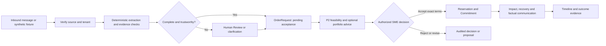
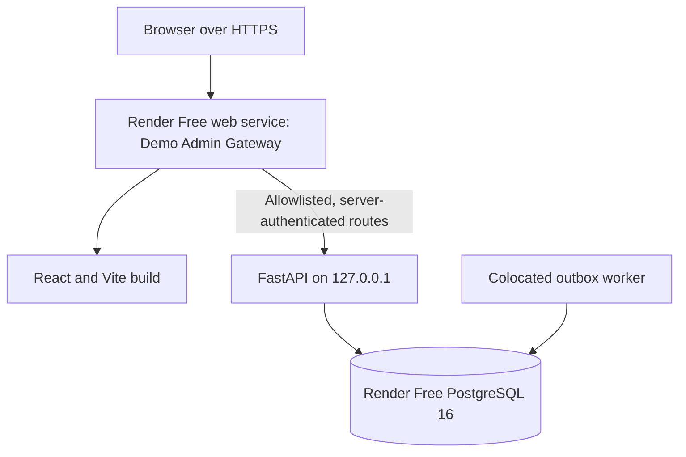

# MouManTAI v2.2 — Commitment Assurance for SMEs

> **Protect the promise, even when the plan changes.**

MouManTAI helps small businesses turn scattered customer messages, stock and capacity information, and disruptions into **traceable decisions about customer commitments**. Staff can see what was requested, what can be fulfilled, what changed, and who authorized the next action.

**[Live HTTPS demo](https://moumantai-demo-gateway.onrender.com/)** · [Repository](https://github.com/jiahui-1101/MouManTAI) · [System requirements](docs/requirements/v2.2/REQUIREMENTS_SYSTEM.md) · [Apache 2.0 license](LICENSE)

The public demo uses **synthetic business data** and a temporary, single Demo Admin account. Ask the team for access. Render Free may need time to wake after inactivity. No provider messages are sent from this demo.

## Why this matters

SME staff often reconstruct an order from chat threads, check stock and schedules elsewhere, then reply before every dependency is known. A supplier delay can invalidate a promise that was reasonable yesterday. MouManTAI is designed for owners, managers, and operations staff who need to answer three connected questions:

1. **What did the customer ask for?** Preserve the original source, identity, message ID, and extracted facts.
2. **Can we commit to it now?** Assess inventory, bill of materials, capacity, dates, and competing demand before acceptance.
3. **What happens when conditions change?** Show impact, alternatives, authorization, and a factual communication trail.

Unlike a chatbot, an interpretation never becomes an order or delivery promise by itself. Unlike a task list, the workspace links decisions to versions, source evidence, resource checks, and an audit trail. Unlike an inventory system, it focuses on the **promise lifecycle** across conversations, feasibility, recovery, and communication.

The intended business outcome is less manual reconciliation and fewer unsupported commitments. The repository does **not** establish measured time savings, model accuracy, or live SME outcomes yet.

## From message to authorized action



An order request remains **pending** until an authorized SME accepts its exact agreed terms and the reservation succeeds. A C3 classification decision only corrects or approves the *classification*; it cannot accept an order or send a message. Recovery plans require explicit, scoped human approval before a separately revalidated execution command. A sent notification is not customer agreement, and a supplier claim is not received stock.

## What is implemented

| Capability | Repository implementation | Public demo scope |
|---|---|---|
| **Context Intelligence** | Source-aware ingestion, deterministic extraction, optional model adapter, versioned evidence, clarification, and C3 review. | Seeded synthetic messages and a C3 review queue; model inference and live channel polling are disabled. |
| **Commitment Registry** | Persisted order requests, commitments, lifecycle transitions, correlated timeline, audit, and transactional outbox. | Authorized Overview and OrderRequest reads and guarded synthetic decisions. |
| **Feasibility Assessment** | Stock/BOM/capacity/date checks; advisory FCFS and OR-Tools CP-SAT portfolio strategies with evaluator revalidation. | OrderRequest feasibility and synthetic resource data; no real Orbyte reservation. |
| **Recovery** | Incident impact, alternatives, and approval-bound execution contracts. | Repository/local synthetic workflows; recovery execution is not exposed through the public Demo Admin gateway. |
| **Communication** | Factual templates, request/outbox state, confirmations, and status intent logic. | Pending synthetic intents can be inspected; outbound Telegram, WhatsApp, and email are disabled. |
| **Human Review** | Separate C3 classification review and order acceptance boundaries, source/version checks, manager authority, and decision audit. | Demo Admin can review/correct classifications and review or accept synthetic OrderRequests through allowlisted routes. |

Forecasting, supplier comparison, and Decision Memory have repository modules and synthetic demonstrations. They are **advisory prototypes**, not validated predictions, supplier integrations, or evidence of learned business improvement. The target behavior is detailed in the [v2.2 requirements](docs/requirements/v2.2/REQUIREMENTS_SYSTEM.md); requirements describe a goal, not proof that every feature is live.

### Deterministic rules, optional AI, human authority

Processing starts with typed validation, catalog and quantity rules, provenance, and freshness checks. The repository contains a shared P1 adapter for selective GLiNER/Qwen inference; model output must pass schema and source-evidence checks and cannot grant authority. In the **public Render demo**, `P1_AI_ENABLED=false`, so classification relies on the deterministic path and Human Review. The RunPod/model adapter is code and configuration, **not a verified live demo integration**. Reply templates use approved facts; any generated wording is subordinate to those facts. No classification, model suggestion, solver result, or forecast automatically accepts an order.

## Public demo walkthrough

1. Open the [public demo](https://moumantai-demo-gateway.onrender.com/). Sign in with Demo Admin credentials supplied privately by the team; there is no self-registration. An unauthenticated visitor should see the login screen, not business data.
2. On **Overview** (`/overview`), inspect the commitment summary and Human Review entry point. Values come from the authorized API and staging PostgreSQL database.
3. Open **Order Requests** (`/order-requests`) to inspect a seeded request, its source/version evidence, review decision, feasibility, and guarded synthetic acceptance flow. Acceptance creates a mock reservation and linked Commitment only when business guards pass.
4. Open **Human Review** (`/human-review`) to inspect a review-required classification and its source provenance. Approve, reject, or correct the classification; this does not accept an order.
5. Refresh or navigate between pages to retain a valid session; use **Log out** to revoke it. Changes to seeded records are durable, so later visitors may see an already decided item.

The public gateway exposes a **narrow** set of Orders, Overview, timeline, and C3 routes. Other repository pages may exist but are outside this public demo. The deployed first-load/login and Orders navigation fix is tracked in [Draft PR #124](https://github.com/jiahui-1101/MouManTAI/pull/124); it is deployed to staging but is not part of the merged Main snapshot used for this documentation branch.

## Architecture and security



**Stack:** React 19, TypeScript, Vite, React Router, TanStack Query; Python/FastAPI, Pydantic, SQLAlchemy, Alembic, PostgreSQL 16; OR-Tools CP-SAT for advisory optimization; Docker for the Render image and local Compose. Shared typed contracts live in [`contracts/`](contracts/README.md).

For this temporary staging topology, Render provides HTTPS at its default domain. The Node gateway serves React and is the only public process. FastAPI binds to loopback; PostgreSQL is managed separately, and the worker runs in the same container. The gateway keeps credentials server-side, uses a hashed Demo Admin password, short-lived HttpOnly/Secure/SameSite cookies, login rate limiting, same-origin and CSRF checks, and an exact route allowlist. Tenant and manager identity are resolved server-side, not accepted from browser role headers. Backend decisions recheck tenant, source/version, idempotency, and business guards. Secret values are **not** Vite variables or frontend bundle content.

This is an isolated **single-tenant synthetic staging** arrangement, not production SaaS identity. Render Free can sleep on inactivity; the colocated worker is suitable for this bounded demo but not a reliability guarantee. Live provider access, broad tenant onboarding, monitoring, and production hosting separation remain future work. See the [staging runbook](docs/handoffs/DEMO_ADMIN_STAGING_RUNBOOK_2026-10-25.md) and [`render.yaml`](render.yaml). Provider outbound flags are disabled there.

## Run locally

Prerequisites: Docker with Compose, Node.js 20+, npm, and Git. Python 3.11+ is needed for direct backend development. Compose is a **local development environment**; do not publish its API or enable synthetic privileged routes on a public host.

```bash
git clone https://github.com/jiahui-1101/MouManTAI.git
cd MouManTAI
cp .env.example .env                 # PowerShell: Copy-Item .env.example .env
# Replace the local PostgreSQL password placeholder in .env.
docker compose up --build -d
curl http://localhost:8000/health
cd frontend
npm ci
npm run dev
```

Open `http://127.0.0.1:5173/`. Compose starts PostgreSQL 16, runs migrations and demo seed data, and starts the API and worker. Vite proxies local API requests to port 8000. The `.env.example` file documents optional integrations; it is **not** evidence they are configured. Keep local secrets in `.env` and never commit it. For a clean stop, run `docker compose down` from the repository root; omit `-v` to retain local database data.

For direct Python work, see [`backend/pyproject.toml`](backend/pyproject.toml), [`backend/alembic.ini`](backend/alembic.ini), and the [backend tests](backend/tests/). The staging gateway has separate startup and credential requirements; use its runbook rather than treating the Vite development server as a public authorization boundary.

## Validation and limits of evidence

- [Merged PR #121](https://github.com/jiahui-1101/MouManTAI/pull/121) records public staging checks for Demo Admin login, session cookie, anonymous rejection, forged origin, cross-tenant headers, CSRF, logout, authorized Orders/C3 reads, and a private raw API boundary at commit `9cebbbfa0b87ecce6668701e49a36f92aaa055e9`.
- That PR records a **local PostgreSQL 16** journey for C3 correction, Orders review, feasibility, mock acceptance, linked Commitment timeline, and pending communication intents. It does not claim a public provider send or public write-through E2E.
- Its exact-head [CI run](https://github.com/jiahui-1101/MouManTAI/actions/runs/40138299227), [P1 run](https://github.com/jiahui-1101/MouManTAI/actions/runs/40138299234), and [C2 run](https://github.com/jiahui-1101/MouManTAI/actions/runs/40138299239) passed. CI covers backend tests including PostgreSQL, frontend typecheck/tests/build, and feature suites. Draft PR #124 carries later public first-load fixes; its CI/deployment status is tracked separately.

Run the core checks locally from the repository root (with a Python 3.11–3.14 virtual environment):

```bash
python -m pip install -e "./backend[dev,optimization]"
python -m pytest backend/tests -q
cd frontend
npm ci
npm run typecheck
npm test
npm run build
```

Real Telegram, WhatsApp, Gmail, RunPod inference, Orbyte APIs, provider outbound delivery, and business impact measurements are **not demonstrated by the public staging deployment**. The dataset is synthetic, so a successful workflow demonstrates mechanics and safeguards, not model accuracy or operational savings. A future pilot should measure decision time, correction rate, prevented stale commitments, and verified fulfillment with consenting SMEs and a documented baseline.

## Team and contribution record

The existing repository team listing names **Wong Jia Hui, Bong Zi Shan, Lee Mei Shuet, Loh Su Ting, and Gan Rui En**. The [team log](docs/TEAM_LOG.md) documents the five historical workstreams—Context, Feasibility, Recovery, Communication, and Shared Core—and their integration handoffs. Individual code authorship or current ownership should be checked against Git history; these workstream labels are not a claim that one person alone wrote each module.

MouManTAI was prepared for the **SDC Hackathon 2026, Orbyte Smart SME Challenge**. Contributions and changes should follow [`AGENTS.md`](AGENTS.md), update relevant tests and contracts, and preserve provenance, tenant isolation, and human decision boundaries.

Licensed under [Apache 2.0](LICENSE).
