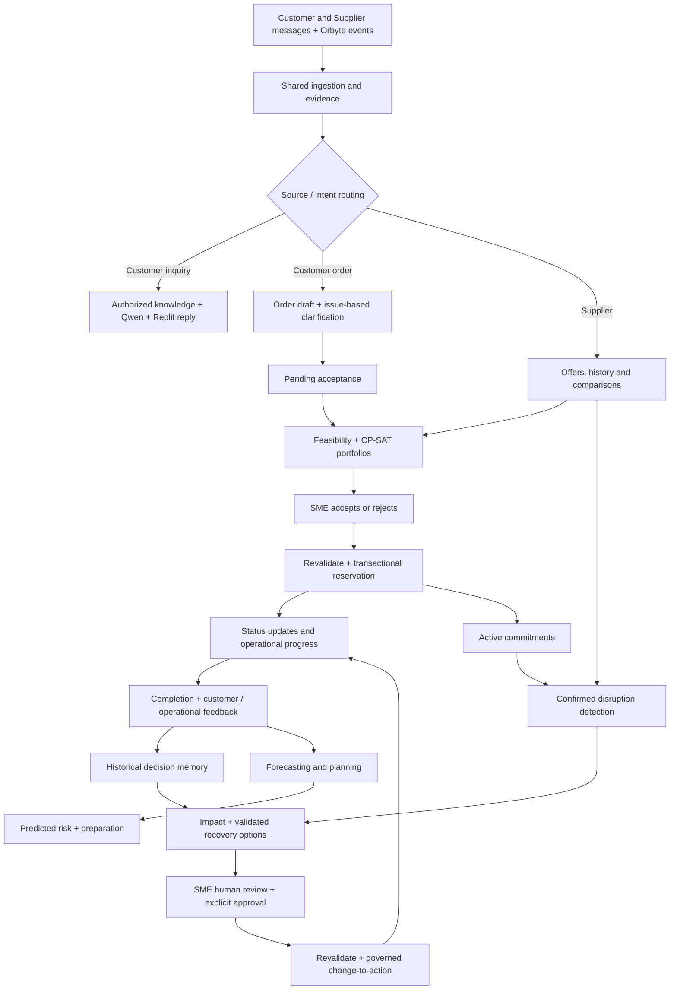

# MouManTAI 2.2 — System Requirements Specification (Reviewed Architecture)

**Product:** MouManTAI — Intelligent SME Operations & Commitment Assurance  
**Tagline:** Protect the promise, even when the plan changes.  
**Context:** SDC Domain 2 / Orbyte Smart SME Challenge  
**Document version:** Implementation Baseline Review v2.2 · 2026-10-23  
**Status:** Target product specification after critical design review. **Not a statement of implemented functionality or of owner approval for new design decisions.**  
**Companions:** [`REQUIREMENTS_FRONTEND.md`](./REQUIREMENTS_FRONTEND.md), [`REQUIREMENTS_BACKEND.md`](./REQUIREMENTS_BACKEND.md), [`AGENTS.md`](./AGENTS.md), **[`IMPLEMENTATION_BLUEPRINT.md`](./IMPLEMENTATION_BLUEPRINT.md)** (v2.2 decisions and implementation sequencing).

## 0. Normative language, provenance and scope

- **[CONFIRMED]**: Explicitly decided by the product owner in the requirements conversation. Implement as written unless the owner changes it.
- **[PROPOSED]**: Recommended full-system capability or implementation design; included so the target architecture can be reviewed. Do not silently convert a proposal into an irreversible business policy.
- **[OPEN]**: An unresolved behavior or policy. Present sensible defaults separately; do not assume it is confirmed.
- **[DESIGN-RESOLVED / REVIEW]**: This revision supplies a specific engineering resolution to a reviewer-identified gap. This is a proposed resolution for product-owner signoff; do not mislabel it as already owner-confirmed.
- **Implementation evidence tiers:** `TARGET` = architecture desired; `DEMO-ONLY` = synthetic demonstration of the mechanism; `VALIDATED` = tested against specified evidence; `LIVE` = independently verified real integration. Never collapse these labels.
- **MUST / MUST NOT**: Binding engineering invariant or a [CONFIRMED] rule. A [PROPOSED] feature's detailed design is conditional on adoption.
- Historical `PERSON_1`–`PERSON_5` and previous `REQUIREMENTS_SYSTEM.md` describe the **legacy implementation baseline**, not the new feature breakdown. Preserve functioning code and invariants; migrate contracts deliberately.
- The product owner asked for the **complete target product**, without constraining the specification to a submission-date MVP. Current repository completeness and external integrations still require independent verification.
- The product owner asked not to expand the long negative-scenario discussion during feature design. This does **not** waive existing 1.0 regression tests or mandatory safety, state, tenant and approval verification. Preserve the legacy E2E regression baseline.

### 0.1 Source decisions already confirmed

1. Three **business characters/perspectives**: **Customer**, **SME**, **Supplier**. Do **not** recreate P1–P5 as user-facing features.
2. Reuse existing WhatsApp / Telegram / Outlook(or email) ingestion, normalization, OCR as needed, GLiNER where appropriate, Qwen analysis, evidence and validation rather than replacing the pipeline.
3. **Qwen interprets/analyzes; Replit is the owner-selected preferred natural-language reply provider**, conditional on verifying a callable API and privacy/credential configuration; backend `ReplyGenerator` and factual `TemplateGenerator` are mandatory. This does **not** claim Replit inference availability. Channel adapter handles actual transport.
4. Customer intents include Inquiry and Ordering. Approved public fixed-price FAQs can receive automatic factual answers; *new* prices, discounts, negotiated quotes, delivery guarantees or commercial commitments require SME review.
5. Ordinary incomplete/ambiguous order fields may be clarified automatically. Track each **Unresolved Issue** separately; **two consecutive clarification attempts without meaningful progress on that issue** escalate it. Progress permits further clarification; risk can escalate earlier.
6. Confirmed orders cannot be silently changed: edits to drafts require verified same-order association and version history; edits to confirmed commitments use Amendment workflow.
7. Complete new orders enter **Pending Acceptance**; unclear cases enter a separate **Human Review** queue.
8. SME Dashboard includes a Calendar with distinct Accepted/Pending orders; shows evidence-based feasibility, stock/expiry/capacity/schedule/profit and reasons for or against accepting.
9. Multi-order analysis uses deterministic feasibility plus **OR-Tools CP-SAT** to compare feasible portfolios under **FCFS / Profit / Expiry-aware** strategies. Recommendations NEVER accept orders; SME decides.
10. Before SME acceptance, revalidate inventory and schedule; reserve the required resources only if current constraints pass.
11. Supplier messages/offers consolidated; automatic same-category comparison and SME-initiated requirement-specific comparison. Hard requirements first; show incompatible differences, pros/cons and source reliability. Past transaction facts distinguished from unverified message claims.
12. Supplier choice belongs to SME; record selection and reason. Subsequent purchase/order communication handoff remains **[OPEN]**.
13. Customer can request the latest authorized order status; **key verified order status changes automatically send progress updates**. `ACCEPTED` means the SME accepted and resources were reserved, not customer signature on revised terms. Do not generate a separate free-form AI acceptance email; send a factual milestone template only.
14. After evidenced fulfillment, offer optional Customer Feedback; use **existing Orbyte/operational events first**, with at most a lightweight SME completion action for missing actuals. Daily planned-versus-actual analysis is reported only for measured data; no mandatory manual production log.
15. **Any Emergency Change-to-Action requires HUMAN REVIEW and EXPLICIT AUTHORIZED APPROVAL before execution**, with revalidation and verifiable outcome. AI must never self-approve.

### 0.2 Product extensions proposed for full target

- **[PROPOSED] Predictive Intelligence:** demand, stock-out/expiry, supplier delay, capacity/deadline risk. A basic baseline and scenario calculation can be demonstrated on synthetic data, but predictive effectiveness requires external or genuine chronologically held-out history. Warning ≠ verified event; synthetic backtest ≠ proof of accuracy.
- **[PROPOSED] Decision Memory:** store context, alternatives, SME reasons and verified outcomes; retrieve comparable historical cases **only when meaningful verified history exists**. For synthetic seed examples, show `DEMO-ONLY`, not genuine evidence of learning. No autonomous LLM self-training.
- **[PROPOSED] Sourcing/RFQ Coordination:** prepare a common RFQ, SME-authorized send, consolidate multiple supplier responses, compare.
- **[PROPOSED] Broader Disruption Handling:** power/water outage, staffing/machine capacity, logistics, stock, supplier, customer amendments.
- **[PROPOSED] Orbyte bidirectional integration:** read authorized business data; surface decision/approval tasks and alerts; receive verified approvals; write back validated business transitions through agreed adapters.
- **[PROPOSED] One SME Business Command Center** for a concise cross-workflow situation overview and drill-down pages.

## 0.3 Objective scope and evidence-based demonstration (design-review resolution)

**Full product remains the goal.** Do not delete confirmed Customer, SME, Supplier, Order Status/Feedback or human-approved Emergency workflows merely to fit a short demo. However, product *breadth* and demonstrated *evidence* are separate:

1. **Primary value chain / hero journey:** fragmented customer message → clarified complete order → SME order feasibility and decision → authoritative reservation → customer status → operational outcome. The demonstration may include a second competing order when demonstrating portfolio value.
2. **Connected supporting journey:** supplier messages/offer comparison → SME selection, with verified vs reported supplier history; supplier inputs can also support Recovery alternatives.
3. **Incident journey:** a confirmed disruption affects an accepted commitment → P2-based impact → recovery options → **one human plan approval** → separately commanded execution → verified result. This is an integrated product capability, not merely a future feature.
4. **Full-target planning & learning:** demand/expiry/capacity/supplier forecasting, historical decision memory and measured daily performance. These remain in target architecture, but never claim demonstrated predictive lift or learned quality from team-generated history. A baseline forecast + synthetic scenario and recorded case with honest provenance are acceptable mechanism demonstrations.

**Product value hypothesis (to validate):** fragmented conversations and resource uncertainty cost SME staff time; the system reduces clarification/reconciliation effort, supports safer order acceptance and helps manage real disruptions. Multiple simultaneous competing pending orders are a supported high-value edge case, **not** asserted to be common across all SMEs. Default to ordinary one-order feasibility if no resource contention exists; reveal portfolio comparisons when two or more pending orders genuinely compete for at least one limited resource or when the owner explicitly requests analysis.

**Observable proof:** preserve old automated E2E tests, add domain-correct workflow demos and collect a manual baseline using timed representative tasks; avoid claims of actual SME savings until participants and sample sizes are documented.

## 1. Business problem, actors and product boundaries

**Problem:** Fragmented customer/supplier conversations, stock records, orders, capacity plans and operational changes force SMEs to repeatedly answer questions, reconstruct orders, compare quotations manually and make time-sensitive decisions with incomplete information.

**Outcome:** *Understand → Decide → Anticipate → Recover → Learn*, with traceable human authority and existing business data.

| Actor | Interaction | Responsibilities and permissions |
|---|---|---|
| Customer | WhatsApp / Telegram / email; optional future portal | Ask questions, initiate/clarify orders, check only their own order status, receive milestones, provide feedback; cannot accept orders on SME's behalf. |
| SME Owner / Manager / Staff | Orbyte-embedded MouManTAI workspace | Review exceptions, compare/orders, accept/reject if authorized, choose suppliers, manage calendars, review forecasts, explicitly approve emergency actions based on role. |
| Supplier | WhatsApp / Telegram / Outlook/email; optional future portal | Send quotations, specifications, availability and ETA changes. A claim is not automatic proof of purchase/delivery. |
| Orbyte (integration) | Adapter contracts (live or labelled synthetic) | Business inventory, product catalog, identity/roles, schedule, approval and notification reference systems subject to available real capabilities. |

**Not an ERP replacement:** Stock and identity remain under designated authoritative systems; MouManTAI maintains derived evidence, assessments, requests and decisions. Do not claim verified Orbyte API capabilities without evidence. Prototype and seed data may be synthetic, clearly labelled.

## 2. End-to-end capability map

This is a logical flow, **not** a claim that all branches run for every message. Forecast alerts cannot by themselves assert a confirmed disruption.

## 3. Shared Business Context & Message Intelligence

**SYS-MSG-01 [CONFIRMED]** Ingest customer and supplier messages across permitted channel adapters. Preserve channel, external message ID, sender identity evidence, source timestamp, thread IDs, attachments and raw/normalized representations.

**SYS-MSG-02 [CONFIRMED]** Preserve prior deterministic/GLiNER/OCR/Qwen extraction and evidence pipeline. Use text directly when machine readable; OCR only as needed; do not infer document role from filenames alone.

**SYS-MSG-03** Produce normalized, schema-validated structured interpretation with `intent`, relevant entities, evidence refs/spans, alternatives, unresolved issues, confidence rationale, source freshness and schema version. Model output is **untrusted**, never an action command.

**SYS-MSG-04** Bind messages to the correct tenant, customer/supplier, conversation and order with verified linkage. Ambiguous links must remain pending clarification or review.

**SYS-MSG-05** Separate supplier claims, operational authoritative facts, confirmed customer replies, computed assessments and future predictions. Expose data provenance to the SME.

**SYS-MSG-06** Maintain message-level ingestion idempotency and source audit, and explicit adapter mode (`LIVE` / `SANDBOX` / `SYNTHETIC`).

## 4. Customer — Inquiry & Customer Knowledge

**SYS-CUS-01 [CONFIRMED]** Detect Inquiry vs Ordering. **[PROPOSED]** support mixed-intent messages and order-status inquiries without discarding other intent.

**SYS-CUS-02 [CONFIRMED]** Customer factual inquiry uses Orbyte business data only after server-side classification into authorized customer-visible context. Cross-customer records, internal costs, margins, private supplier information and other restricted data are not disclosed.

**SYS-CUS-03 [CONFIRMED role ownership / DESIGN-RESOLVED provider resilience]** Qwen performs interpretation, question matching and risk analysis. Replit API is the selected LLM-based natural-language ReplyGenerator. **Status, milestone and stable approved factual FAQ replies use deterministic verified templates by default**, optionally polished by Replit only if validation permits; customer free-form questions may use Replit with typed evidence. Use a `ReplyGenerator` interface with `ReplitGenerator` and `TemplateGenerator` fallback. Never mistake Replit hosting/credits for a verified inference API endpoint. Actual channel adapter handles sending. On model/provider outage use approved template when facts suffice; otherwise queue Human Review. No AI-generated prices, ETA or authority.

**SYS-CUS-04 [CONFIRMED]** When question is grounded, safe and authorized, auto-reply. When uncertain, unsupported, privacy-sensitive or commercially consequential, route to Human Review with **original message + Qwen analysis + extracted understanding + reason for uncertainty + evidence + editable proposed reply where safe**.

**SYS-CUS-05 [CONFIRMED]** Approved and current *fixed public price FAQ* may auto-reply as factual information. New quotes, discounts, personalized prices, nonstandard conditions or delivery guarantees require SME review. Do not treat every mention of money as automatically prohibited.

**SYS-CUS-06** A sent reply is not the same as delivered, read, accepted or fulfilled; use actual provider receipts and reasoned state.

## 5. Customer — Conversational Ordering & Human Review

**SYS-ORD-01 [CONFIRMED]** For explicit order intent, create or safely associate a versioned `OrderRequest` / `OrderDraft`; extract configurable required fields (product/SKU, quantity/unit, delivery/pickup date/time/location, contact and business-specific options).

**SYS-ORD-02** Distinguish `MISSING`, `AMBIGUOUS`, `CONFLICTING`, `VALID`, `UNSUPPORTED`, and `UNVERIFIED` field states. Never fill unknown product, date, quantity or customer approval by guesswork.

**SYS-ORD-03 [CONFIRMED]** Automatically ask safe, targeted questions for ordinary missing/ambiguous product/quantity/date fields. Where useful, group related questions rather than one field per round trip; do not ask for already validated facts.

**SYS-ORD-04 [CONFIRMED] Issue-based adaptive escalation:**
- Maintain independent `UnresolvedIssue` identifiers, expected field(s), evidence and `consecutive_no_progress_count`.
- **Meaningful progress is judged deterministically**, not by Qwen confidence alone: required SKU matched to allowed catalog ID; candidate set strictly reduced with evidence; positive quantity + normalized unit passes validator; specific date/time in business zone passes parser and operating policy; customer chooses a previously offered allowed option. Mere rephrasing, new uncertainty or unvalidated model guesses do not count. Partial validated progress can reset only the involved issue.
- First no-progress attempt may generate a clearer question/options; on **two consecutive no-progress attempts for the same issue**, escalate to Human Review.
- If waiting for customer reply, do not increment no-progress attempts because of elapsed time or provider failure. **Add separate P4-style no-reply workflow**: tenant-configured response due time → **one idempotent reminder** if permitted → expiry or Human Review after a later configured deadline. Sample defaults for fixture **24h reminder / 48h escalation** only; real policy requires business timezone, channel rules and owner configuration. Do not repeatedly send reminders.
- Bound the overall loop with a configurable total clarification-turn budget and maximum age; if those are reached even with small apparent progress, route to Human Review without guessing. Idle cases remain distinguishable from two unsuccessful answered attempts.
- Commercial-risk, identity/security-sensitive or unsafe scenarios can escalate immediately regardless of attempt count.
- Store question/answer history and reasons so SME can take over without repeating the conversation.

**SYS-ORD-05 [CONFIRMED]** An unconfirmed draft may incorporate corrected information only when safely linked to the same order; append prior value and evidence/version. A confirmed order change enters `AMENDMENT_PENDING` and requires relevant SME authorization, customer agreement when terms change, and renewed feasibility/reservation checks.

**SYS-ORD-06 [CONFIRMED]** If all required information is valid, set `PENDING_ACCEPTANCE` and place in the separate Order Decision Queue; incomplete/unsafe flows enter Human Review or Awaiting Customer, never acceptance automatically.

**SYS-ORD-07 [CONFIRMED]** SME chooses Accept/Reject; Qwen/Replit may explain only, not approve or reserve stock on their own.

## 6. SME — Command Center, Calendar & Decision Support

**SYS-SME-01 [CONFIRMED]** SME dashboard exists as an Orbyte branch/module. Distinguish `Pending Acceptance` and `Human Review` as separate task queues; preserve original customer details, message received time, channel, requested products/quantity/deadline, evidence and updates.

**SYS-SME-02 [CONFIRMED]** Calendar displays **both Accepted and Pending** orders, clearly separated. Click day/order for product, times, expected workload, allocations, pending demand and capacity. Pending visibility does not imply reserved resources.

**SYS-SME-03 [CONFIRMED]** For each complete pending order, display recommended decision **with reasons**, including deterministic inventory/BOM, expiry, reservation, confirmed incoming supply, capacity, employee/machine schedule, deadlines, logistics and estimated profitability when data supports them. Show `FEASIBLE`, `CONDITIONAL`, `INFEASIBLE`, `UNKNOWN` explicitly.

**SYS-SME-04 [CONFIRMED]** Offer order sorting/filtering and strategy comparisons with `FCFS`, `PROFIT`, `EXPIRY_AWARE` across **multiple pending orders**, not independent row scores only.

**SYS-SME-05 [CONFIRMED algorithm family / DESIGN-RESOLVED single-kernel safety]** Use the **existing P2 deterministic feasibility evaluator as the single authority for business constraints**, with OR-Tools CP-SAT only for combinatorial search/scheduling. Both MUST consume one versioned normalized constraint input or derive solver clauses from the same canonical constraint builder; do not implement a conflicting ATP/BOM/expiry calculator. **For every portfolio returned by CP-SAT, re-run the common evaluator over the full projected shared-resource allocation AND every selected order** (not merely one-by-one against the original snapshot). Any disagreement → `VALIDATION_MISMATCH`, reject recommendation, capture diagnostic. Accepted commitments fixed. If fewer than two pending orders compete for resources, simple P2 per-order assessment is the normal path.

**SYS-SME-06** Distinct objectives:
- `FCFS`: deterministic earliest-eligible-time greedy feasible inclusion over the same common feasibility rules; **FCFS does not need CP-SAT**. The unified Optimization API may return FCFS + CP-SAT-derived Profit/Expiry results. **[PROPOSED]** use earliest verified order-request received time; retain information-completion time and tie-break by immutable order ID.
- `PROFIT`: maximize estimated incremental contribution/profit **only from verified/configured cost assumptions**, not revenue or invented expenses. Revenue source = approved Orbyte catalog price or SME-approved explicit customer quote/version; variable cost source = Orbyte SKU/BOM/stock valuation, configured labour/overhead allocation and logistics where recorded, with currency/validity/evidence. If critical revenue/cost inputs missing, report `PROFIT_COMPARISON_UNAVAILABLE` and preserve FCFS/expiry feasible views; do not impute missing cost with Qwen.
- `EXPIRY_AWARE`: allocate safe valid lots considering FEFO and minimize *avoidable* waste in a horizon without violating product safety, fixed orders or actual deadlines.
- Support no solution / unavailable inputs / unknown solver status explicitly. Explain why excluded orders are hard-infeasible vs simply not chosen under an objective.

**SYS-SME-07 [CONFIRMED]** The solver result is an **advisory portfolio**, not a batch acceptance. SME chooses individual orders or an explicitly reviewed group. On Accept: validate authenticated role, version, latest stock/lot/capacity/schedule, then atomically/equivalently reserve resources in the authoritative allocation system; only mark Accepted after reservation success. On failure stay Pending with reasons.

**SYS-SME-08 [PROPOSED]** Daily utilization/what-if views display commitments, expected additional load, future forecast risks and distinguish fact from simulation.

## 7. Customer — Order Progress, Retention & Feedback

**SYS-STAT-01 [CONFIRMED]** Customer may query status for orders they are authorized to see. Qwen identifies a status inquiry; retrieve an authoritative state scoped to the verified customer–order link. Default to an approved factual template, with Replit only as optional wording assistance after a grounded response is available. Never let a generative model invent order progress or ETA.

**SYS-STAT-02 [CONFIRMED]** Key **verified** state transitions trigger automatic milestone updates to that customer's appropriate channel, subject to channel connectivity and messaging/consent rules. No separate free-form AI order-acceptance email is needed; Accepted itself can trigger the approved status notification. SME sees the same authoritative state.

**SYS-STAT-03 [DESIGN-RESOLVED / REVIEW]** Customer-friendly status mapping from **canonical states**, configurable by business: `REQUEST_RECEIVED`, `INFORMATION_REQUIRED`, `UNDER_REVIEW`, **`ORDER_ACCEPTED` (display: "Your order has been accepted by the business")**, `PREPARING`, `READY`, `OUT_FOR_DELIVERY`, `COMPLETED`, `CHANGE_PROPOSED`, `REJECTED`, `CANCELLED`. **Do not display "Customer confirmed revised terms" merely because SME accepted an order.** `COMPLETED` is permitted only when canonical `fulfillment_state=FULFILLED` has credible completion evidence; manual reported completion awaiting proof is `COMPLETION_REPORTED` (internal) / "Completion being verified" where customer-visible. Not all industries require all interim milestones.

**SYS-STAT-04** Do not promise exact delivery time or `OUT_FOR_DELIVERY`/`COMPLETED` without authoritative status/evidence. Notification enqueue/send != delivered/read.

**SYS-FB-01 [CONFIRMED]** On completed orders invite optional feedback on satisfaction/quality/service/delivery and allow written comments; preserve linkage and consent. **[OPEN]** precise invitation cadence, template and channels.

**SYS-FB-02 [CONFIRMED goal / DESIGN-RESOLVED low-burden capture]** Prefer Orbyte operational events and existing state timestamps to derive due/accepted/completed/late counts. Where Orbyte lacks completion evidence, permit a **single SME "Mark complete"** entry with evidence/status, but do not treat an unsupported click as externally verified delivery. Actual production durations, stock use and deviation cause are **optional unless an authoritative source exists**. Only compare planned versus actually measured units/hours when coverage is available; otherwise label gaps, not missing data as zero. The system MUST NOT impose a new mandatory daily production log.

**SYS-FB-03 [PROPOSED]** Use verified actuals to recommend capacity-parameter review, refine forecast evaluations and ground historical insights; business-critical rules cannot be silently rewritten by AI.

## 8. Supplier — Offers, Comparison & History

**SYS-SUP-01 [CONFIRMED]** Ingest Supplier messages/attachments with the shared channel/OCR/Qwen pipeline; maintain Supplier Detail profile, communication timeline, quote versions, products/specifications, MOQ, price units, lead time, delivery terms, validity and source evidence.

**SYS-SUP-02 [CONFIRMED / DESIGN-RESOLVED specification authority]** Automatically group same-category offers only where normalized SKU/product identity is supported; allow SME-initiated comparison with explicit requirements. For each category, the **versioned specification schema** comes from Orbyte Product Catalog where available, otherwise an SME-owned category configuration (e.g., packaging: volume, material, heat-safety; perishables: grade, storage/freshness constraints). Qwen extracts candidate fields but cannot invent mandatory schema dimensions or mark unknown values compliant.

**SYS-SUP-03 [CONFIRMED]** Evaluate required product properties as Hard Requirements first. Show matching, conditionally matching, unknown and incompatible offers; explain all differences even if rejected as substitute. Never claim two goods interchangeable based on price or broad category alone.

**SYS-SUP-04 [CONFIRMED]** Provide side-by-side pros/cons, normalized comparable unit costs *with conversion basis*, MOQ, total quantities, freshness/size/quality/expiry where relevant, ETA, supplier claims vs verified availability, and operational constraints. Avoid absolute supplier rankings unsupported by SME-specific requirements.

**SYS-SUP-05 [CONFIRMED]** Combine Orbyte recorded transaction/delivery history with incoming supplier messages while **strictly separating verified events from unverified claims**. Show evidence coverage; do not infer actual receipt from supplier self-report. Historical stats need denominators and low-sample warnings.

**SYS-SUP-06 [CONFIRMED]** SME decides selected supplier; record identity, quote version, other offers considered, date and reason. Do not auto-create binding purchase obligations solely because of supplier selection. The purchasing/communications handoff is **[OPEN]**.

**SYS-SUP-07 [PROPOSED]** RFQ/sourcing coordination: SME specifies requirement and supplier list; system prepares inquiry; SME approves outbound inquiry; channel adapters collect responses into a common sourcing case, mark unanswered/missing facts and update comparison.

**SYS-SUP-08 [DESIGN-RESOLVED / REVIEW]** A selected supplier quote can be referenced by an emergency `ALTERNATIVE_SUPPLY` recovery **candidate**, but its feasibility defaults to `CONDITIONAL` until stock availability, specification equivalence, lead time and SME-approved purchasing/transport dependencies are verified. Supplier selection alone does not create inventory, a PO, shipment, procurement execution approval or a recovered commitment.

## 9. Predictive Intelligence / Forecasting

**SYS-FORE-01 [PROPOSED]** Supply four useful forecast families: demand by SKU/time, stock-out and waste/expiry risk, supplier ETA/delay risk, capacity/deadline risk. Use historical authoritative records and current context, not model improvisation.

**SYS-FORE-02** Each run records type, entity and tenant, forecast horizon, training/input window, model/baseline version, assumptions, data sufficiency, estimated values or risk probabilities, quantiles/intervals where justified, provenance and generation time.

**SYS-FORE-03 [DESIGN-RESOLVED evidence levels]** Begin with a transparent moving-average/seasonal-naive baseline and explicit deterministic stock/capacity scenario calculations. On synthetic histories, all forecasts and backtests are labelled **`DEMO-ONLY` / `SYNTHETIC`**, validating only pipeline mechanics, **not** real prediction skill. Genuine predictive claims need time-ordered held-out data external to the generating process or collected operational history and comparison against naive baseline. Sophisticated ML remains in full-product target after this evidence gate, not removed from the architecture.

**SYS-FORE-04** Convert forecast output to **proactive warnings and possible preparation options**, showing magnitude, uncertainty and affected future periods. Do not convert predictions into verified stock, supplier promises or confirmed disruptions.

**SYS-FORE-05** Use forecast as an *advisory* view during order acceptance, supplier sourcing and upcoming schedule, while hard feasibility remains based on confirmed resources/approved reservations.

**SYS-FORE-06** Compare subsequent **genuine** actuals against prediction, evaluate bias/error/calibration with sample size, source and confidence; synthetic follow-up can demonstrate the calculation but NOT establish real calibration. Human reviews updates to business rules or decision thresholds. No historical records ⇒ `INSUFFICIENT_HISTORY`, not a fabricated forecast.

## 10. Emergency & Human-Approved Change-to-Action

**SYS-EM-01 [CONFIRMED core / PROPOSED broader triggers]** Retain original Impact + Recovery + Action code as a reusable Emergency Management capability. Potential disruptions include supplier delay, unexpected inventory reduction, capacity/utility/logistics outage and accepted-order amendment.

**SYS-EM-02** Distinguish `PREDICTED_RISK`, `REPORTED_DISRUPTION`, `CONFIRMED_DISRUPTION`, `RESOLVED`. The system may automatically create an alert and analyze facts; must not use speculative evidence as a verified incident.

**SYS-EM-03** For each confirmed incident, link affected commitments based on shared deterministic feasibility under current snapshots, not simply all orders associated with the supplier. Severity, affected orders, evidence and unresolved assumptions are visible.

**SYS-EM-04** Generate multiple feasible/conditional recovery options when possible: reschedule, alternative supply, local sourcing, resource reallocation, partial fulfilment, request customer amendment, manual escalation. Compare cost, delay, impact, evidence, hard constraints and source reliability. **Do not fabricate an option if no safe plan exists.**

**SYS-CTA-01 [CONFIRMED, NON-NEGOTIABLE]** For **every emergency Change-to-Action**, an authorized SME human **MUST REVIEW** the exact proposed plan/actions and **MUST EXPLICITLY APPROVE** before any action-execution side effect. No autonomous emergency execution, regardless of confidence, internal/external target, or past trust. Automatic analysis, alerts, simulations and **draft** generation are allowed, not execution.

**SYS-CTA-02 [DESIGN-RESOLVED / REVIEW]** **One human approval per coherent recovery plan**, not one approval click per low-level action. The exact plan enumerates **every included action** and binds `tenant_id`, actor/role, incident, plan ID/version, authorized action IDs/scope/cost ceilings, snapshot/preconditions, timestamp and expiry. Use **two separate commands**: `APPROVE_PLAN` grants a **single-use scoped authorization**, and `EXECUTE_APPROVED_PLAN` consumes it only after revalidation. Approval does **not** automatically execute, and approval or execution is not outcome success. Automatic analysis, harmless risk notifications and draft creation are outside CTA execution; changing business tasks/resources as part of CTA is inside its approved plan.

**SYS-CTA-03** After approval but **before** any action execution, revalidate affected commitments, resources, permissions, plan and approval. If material changes invalidate the approved plan, stop and seek **new human review and approval**. Never auto-expand execution scope.

**SYS-CTA-04** Execute only allowlisted typed actions with idempotency/reconciliation, preserve submitted/running/verified/failed/partial states, record actual provider/mock evidence; an API `200/202` is not fulfillment.

**SYS-CTA-05** If plan changes customer terms, obtain required SME authorization **and customer agreement** to the exact version, then update commitment states through Core. Communication sent ≠ customer agreed ≠ order fulfilled.

**SYS-CTA-06** Incident outcome and lessons are recorded for review. Approval workflow and plan history must be explainable and discoverable in one workspace.

## 11. Historical Decision Memory & Continuous Learning

**SYS-MEM-01 [PROPOSED]** Capture a `DecisionMemoryCase` for significant order, supplier, capacity or emergency decisions: situation, alternatives, business context snapshot, SME decision/reason, proposed/approved/executed actions, verified/unknown outcomes.

**SYS-MEM-02 [DESIGN-RESOLVED evidence gate]** Similarity lookup can suggest prior cases only after a minimum eligible pool with verified contextual attributes/outcomes is available; **do not fabricate a success track record from a few synthetic seed cases**. Demo sample cases must be `DEMO-ONLY`. If no sufficient history, show `INSUFFICIENT_CASE_HISTORY` and retain the current analysis without history-based recommendation. A previous choice is not proof of optimality or current approval.

**SYS-MEM-03** Use verified outcomes to improve dashboards, supplier reliability denominators, capacity estimates and forecast evaluations, requiring governance for policy or model updates.

**SYS-MEM-04** No automatic self-training/fine-tuning LLM on unverified chats, decisions or customer feedback.

## 12. Orbyte integration and shared policies

**SYS-ORB-01 [CONFIRMED direction]** MouManTAI is an Orbyte-embedded business function and should reuse existing Orbyte business records; do not require SMEs to duplicate stock, product and schedule maintenance in an entirely separate ERP.

**SYS-ORB-02 [PROPOSED contract]** Bidirectional exchange:
1. Authorized Orbyte business/identity/role/operational data → MouManTAI.
2. MouManTAI decision/review/forecast/incident outputs → Orbyte workspace/notifications.
3. Authenticated SME decision/approval → MouManTAI via verifiable callback/command.
4. Validated business result → authoritative Orbyte/operational system; reconciliation → Audit.

**SYS-ORB-03** Introduce explicit `LIVE`, `MOCK`, `SYNTHETIC` adapter modes. Orbyte endpoint shapes/auth capabilities remain unknown until officially provided. Never label a mock as a real connection.

**SYS-ORB-04** Configurable business policies: tenant, products, order required fields, units, business hours, lot/expiry rules, BOM, capacity, prioritization objective, public knowledge whitelist, role approval map, communication consent/templates and forecast thresholds.

**SYS-SEC-01** Tenant isolation, least privilege, field-level public-knowledge filtering and minimal external-AI disclosure enforced in backend; untrusted messages/prompt injection cannot give the system authority.

**SYS-SEC-02** Stable IDs, ISO 8601 offset-aware timestamps (UTC storage), `Decimal` values for money/quantity, immutable source evidence, versions, audit, event outbox and idempotent side-effect processing.

## 13. Canonical lifecycle, acceptance and agreement semantics [DESIGN-RESOLVED / REVIEW]

These definitions resolve the old `OPEN-02` ambiguity **for this review draft**. Keep existing legacy Core fields as the canonical source rather than mirroring independent mutable authority across all new tables. The exact event names/enums are target contracts and must be reconciled with the actual repository before migration.

| State / concept | Single authoritative meaning | Evidence / write authority |
|---|---|---|
| `OrderRequest.PENDING_ACCEPTANCE` | Required request fields valid; **no resources reserved** | Conversation + evidence; order request service |
| `OrderRequest.ACCEPTED` | Authenticated SME accepted the original requested terms **and authoritative reservations succeeded** | Order acceptance command, reservation receipts and audit |
| `Commitment` | Created/activated from accepted request, with link `source_order_request_id`, `terms_version`, reserved resources | Shared Core only; **no independent duplicate "accepted" boolean** |
| `Commitment.agreement_state=CONFIRMED` | Both sides agreed to **these exact terms**. For an original explicit Customer order with unchanged terms: original Customer request **plus SME acceptance** is sufficient agreement evidence; **no separate Customer click**. | Original customer message/terms + SME acceptance and matching version |
| `Commitment.agreement_state=OFFERED` / `AMENDMENT_PENDING` | SME proposes **different terms**; prior confirmed terms remain in effect until customer consents and SME/feasibility constraints succeed | Proposal version + outbound state + confirmed customer assent |
| `Commitment.fulfilment_state=FULFILLED` | Evidence of required actual fulfilment; not merely SME acceptance, message sent or production claimed done | Authenticated operational/delivery receipt or business-approved equivalent evidence |
| UI/customer `ORDER_ACCEPTED` | SME accepted & reserved; wording "Your order has been accepted by the business" | Projection of order acceptance; **not a claim of separate customer re-confirmation** |
| UI/customer `COMPLETED` | **Only projection of `FULFILLED`**, with applicable fulfilment evidence; otherwise `COMPLETION_REPORTED` internally / verification pending | Projection from Core fulfilment |
| `SENT`, `DELIVERED`, `READ` | Provider-scoped communication states; never prove term assent | Communication service |
| `APPROVED`, `EXECUTED`, `VERIFIED` | Separate plan authority, side effect attempt and verified consequence | Recovery action governance |

**Transition contract (original unchanged order):** `DRAFT → AWAITING_CUSTOMER / HUMAN_REVIEW → PENDING_ACCEPTANCE → (SME_ACCEPT + RESERVE) → ACCEPTED + Commitment(version 1, agreement_state=CONFIRMED with original request evidence) → operations → FULFILLED → customer COMPLETED`. The order is only customer-visible as accepted after reservation succeeds. If the initial request was not an unambiguous customer offer, stay `AGREEMENT_PENDING` and do not present as mutually agreed.

**Transition contract (changed terms):** accepted version `v` remains authoritative; create `Proposal(v+1)` with `OFFERED`/`AMENDMENT_PENDING`; obtain unambiguous customer consent to **exact** new terms, SME authority and fresh feasibility/reservation adjustment; only then promote `v+1` to confirmed. **Sending the proposal is not consent.**

Other independent dimensions remain valuable (`feasibility_state`, `risk_state`, `recovery_state`, `communication_state`), but each is written **only by its owning aggregate/service**. Derived order status/notification/calendars are read-model projections, not a second writable fact store. `UNKNOWN` is not false/true. `PREDICTED_RISK` is not `CONFIRMED_DISRUPTION`. Supplier claim is not received goods.

Customer milestone wording is an **allowlisted template**, not a natural-language reinterpretation of `CONFIRMED`. A failed notification does not roll back an already accepted order.

### 13.1 Exact terms and price provenance — FINAL IMPLEMENTATION RESOLUTION [DESIGN-RESOLVED / REVIEW]

**`accept` can accept ONLY the exact customer-agreed terms** (original explicit offer OR customer-assented Proposal), never a unilateral SME revision. Build a canonical `OrderTerms` including SKU/variant, quantities/units, delivery or pickup timing and location, applicable approved public or approved quoted **price/fees/currency/discounts**, special conditions, and binding policy reference. Each accepted price must retain `price_source_type`, catalog/quote ID, immutable source version and evidence that the customer was shown/acknowledged the price at the relevant time. A customer order that omits an essential commercial term is not automatically evidence of agreement to a new SME-assigned price. Use safe structured canonicalization and a versioned `terms_hash`; AI wording is not evidence of term equality.

- **Original explicit unchanged offer:** matched customer-offered terms hash + SME accept decision + successful authoritative reservation -> `ACCEPTED`, linked Core Commitment, initial agreement `CONFIRMED` with original customer evidence. `ORDER_ACCEPTED` milestone may send automatically as a factual template.
- **Any material deviation:** changed SKU/quantity, price/fees, date/time, fulfilment location/method or critical condition -> `accept` must return `409 TERMS_MISMATCH / PROPOSAL_REQUIRED` **without reserving or marking accepted**. SME creates exact versioned `Proposal`; customer explicitly assents to that proposal/version; SME rechecks resources and only then accepts. For a *not-yet-accepted* order this is an initial counteroffer, not a false `Commitment(v+1)`. For an already accepted Commitment this is `Amendment(v+1)` and old terms stay authoritative until agreement succeeds.
- **Distributed resource reservation:** asynchronous/external reservation may produce `ACCEPTING` (never `ACCEPTED`) until authenticated receipt and Core reconciliation succeed; preserve idempotency and release/reconcile stranded reservations rather than showing false success.
- **Completion:** `COMPLETED` only from evidenced `FULFILLED`; a one-click staff report may remain `COMPLETION_REPORTED` until business-profile evidence policy allows verification.

This resolves the reviewer's highest-impact loophole. It refines the owner-confirmed *human acceptance and agreement* invariant; mark the exact price/initial assent interpretation for final owner ratification.

### 13.2 One capability/evidence matrix, not a third set of statuses [DESIGN-RESOLVED]

For each capability maintain **one requirement decision** (`CONFIRMED` / `PROPOSED` / `OPEN` / `DESIGN-RESOLVED/REVIEW`) and **one implementation evidence tier** (`TARGET` / `DEMO-ONLY` / `VALIDATED` / `LIVE`) with optional tested-on/version/source references. `MUST` means a normative rule, not a third status axis. See [`IMPLEMENTATION_BLUEPRINT.md`](./IMPLEMENTATION_BLUEPRINT.md) §2.1 for the cross-module matrix. Neither `[CONFIRMED]` nor `TARGET` means the actual repository currently implements the feature.

## 14. End-to-end acceptance journeys

**E2E-CUS:** Authorized public inquiry → grounded Replit reply; explicit order intent → extracted draft → safe issue-based clarification → Pending Acceptance or Human Review.

**E2E-ORD:** Multiple Pending Orders + Orbyte inventory and Calendar → deterministic constraint evaluation → CP-SAT FCFS/Profit/Expiry-aware portfolios with reasons → SME decision → revalidated reservation → authoritative order state.

**E2E-STAT:** Customer with verified order association queries progress; status from Core; key authoritative milestones trigger outgoing notification and SME-visible timeline; completion → optional customer feedback + actual-capacity review.

**E2E-SUP:** Incoming mixed supplier quotations → normalized units/specs and provenance → auto group or on-demand comparison → hard requirement check, incompatible differences and evidence-grounded history → SME selected offer/reason recorded without automatic purchase.

**E2E-FORE [PROPOSED]:** Historical data → evaluated forecast with uncertainty → possible future supply/capacity risk on calendar → safe preparedness advice → actual observations improve evaluation.

**E2E-EM:** Verified supplier/capacity/stock disruption → affected accepted commitments + shared feasibility → explainable recovery options → SME reads exact plan and explicitly approves → revalidate → execute authorized scoped actions → verify outcome/customer agreement separately → decision memory.

## 15. Rubric alignment, value baseline and risks/fallbacks

| Criterion | Evidence required to support claim |
|---|---|
| Innovation & Creativity (30%) | Customer inquiry+clarification, **resource-contention scenario** demonstrating FCFS vs profit vs expiry trade-off, spec-grounded supplier comparison and human-approved change-to-action; future forecasting/memory labelled separately. |
| Problem–Solution Fit (25%) | Verify actual SME pain with owner/staff interviews or observed task trials; show one integrated operational story, not an unsupported claim every SME has simultaneous competing pending orders. |
| Feasibility of Build (25%) | Runnable UI→API→persisted state across shared P2 feasibility→human acceptance→reservation→milestone; Orbyte mock contract honest; existing legacy E2E regression stays active. |
| Clarity of Proposal (20%) | One hero journey with supporting supplier/emergency branch, exact data origins, before/after task timing and acknowledged assumptions. |

**Value baseline protocol (mandatory before ROI claim):** Select comparable representative activities (e.g., answering public FAQ, extracting missing order details, reviewing feasibility, consolidating three supplier quotes, handling one supplier delay). Time the **manual baseline** with a defined scripted case and participant/sample count; then time the same case with MouManTAI, including review/verification work. Report median/mean, variance/range, errors, data quality and whether participants are students or actual SME operators. If no measured baseline, state an **estimated qualitative benefit only**; do not invent savings, revenue uplift or customer retention effects.

**Evidence protocol:** Synthetic cases may demonstrate mechanisms and regression properties, NOT real model predictive performance, adoption, accuracy generalization, customer retention or real supplier reliability. Record fixtures, labels, evaluator, samples, run date and test result. Preserve original baseline tests, especially duplicate event, stale plan, no approval, ambiguous response, tenant boundary and reservation integrity. Product-owner request to defer *discussion* of the long negative scenario catalogue does not waive security regressions.

**Risk & fallback register:**

| Risk | Observable trigger | Safe fallback |
|---|---|---|
| Qwen / external inference unavailable | Request error/timeout or insufficient evidence | Deterministic known-field parse where valid; Human Review; never fabricate parsed terms |
| Replit generation unavailable or endpoint unsupported | Adapter failure or no verified inference API | `TemplateGenerator` on approved factual state/FAQ; otherwise Human Review, no invented send |
| Channel connection not available | OAuth/webhook/provider error | Clearly flagged `SYNTHETIC` channel simulation, delivery status separate |
| Profit prices/costs incomplete | No approved revenue or incremental cost basis | `PROFIT_COMPARISON_UNAVAILABLE`; FCFS/Expiry feasible views remain |
| CP-SAT infeasible/timeout/mismatch | Timeout, solver unknown, shared-evaluator disagreement | Fall back to **P2 per-order feasibility** with limited advisory options; do not call partial search result optimal or valid if mismatched |
| Orbyte API unavailable | No official schema, auth or reservation command | Isolated `mock_orbyte` bounded context behind `BusinessDataReader` + `BusinessCommandPort`; label synthetic, don't claim live integration |
| Forecast lacks credible history | Insufficient real chronological records | Simple descriptive scenario / moving-average baseline labelled demo; no predictive accuracy claim |
| Decision-memory sparse | No verified prior outcomes | `INSUFFICIENT_CASE_HISTORY`, rely on current evidence and feasibility |
| Supplier spec ambiguous | Missing category schema or unverified dimension | `UNKNOWN/CONDITIONAL`, show differences, never force equivalence |
| Manual actuals too burdensome | No native production feeds | One-click SME completion if permitted; planned-vs-actual dashboard discloses missing duration/quantity proof |
| Stale/duplicate/unapproved CTA | Changed snapshot, duplicate action, missing approval | Reject/review, scoped idempotency, no side effect |

**Full-target direction remains:** forecasting and historical decision memory are designed and retained, but must pass evidence gates before production-impact claims.

## 16. Owner signoff and unresolved external contracts before adopting v2.2

| ID | Open question / proposed default |
|---|---|
| OPEN-01 | Milestone list, timing, permission/consent and channels for automatic customer status updates; default verified business milestones only. |
| RESOLVED-02 | [DESIGN-RESOLVED / REVIEW] `ACCEPTED` = SME acceptance + resource reservation; original unchanged customer request may form agreed terms; revised terms require explicit customer consent; `COMPLETED` only projects evidenced `FULFILLED`. Owner should ratify this mapping. |
| OPEN-03 | Customer feedback invitation timing/template and whether SME may opt out. |
| OPEN-04 | Supplier selection → actual purchase/RFQ and any required human send confirmation beyond selected supplier record. |
| OPEN-05 | Whether FCFS means first authenticated *order-request received* time (recommended), information-complete time, or SME-specific rule. |
| OPEN-06 | Which business/industry profiles and forecasting horizons should be supported first. |
| OPEN-07 | Which emergency categories/actions the full system is allowed to execute via real Orbyte adapters; all still require exact human approval. |
| OPEN-08 | Authenticated Orbyte API contracts, available integration scope, business-data owner and write-back transaction semantics. |
| OPEN-09 | Whether additional user-configurable optimization weights/criteria are desired beyond the three confirmed strategies. |
| OPEN-10 | Real SME business rules for issue-independent no-reply reminder/expiry timers, total clarification budget, and status milestone templates; fixture timing is illustrative only. |
| OPEN-11 | Required Supplier category specification profiles and authoritative Orbyte price/cost feeds for profit analysis; use UNKNOWN when absent. |
| OPEN-12 | Minimum verified operational history needed before forecast/decision-memory capability is presented as validated rather than synthetic demo. |

## 17. Legacy-to-v2.2 migration and traceability [DESIGN-RESOLVED / REVIEW]

**Never create a second canonical table just because the v2 specification chose a new name.** First run read-only schema/migration/ORM/repository inspection in the actual git checkout. The mapping below is a **design mapping hypothesis** from legacy requirement terminology, **not a verified table inventory**.

| Existing legacy domain name (verify actual ORM/table) | Target role / mapping | Decision |
|---|---|---|
| `inbound_messages` / context source messages | canonical `SourceMessage` with channel and evidence | **REUSE**, do not add duplicate `source_messages` unless migration genuinely necessary |
| `BusinessContext`, existing order context/extraction | structured interpretation + draft fields | **REUSE/EXTEND** with conversation issue, order identity and version |
| `context_reviews` / existing review queue | generalized typed `HumanReviewTask` | **EXTEND** existing task model if compatible; avoid parallel review decisions |
| Existing request/order identifier | `OrderRequest` pending flow | **EXTEND**, one order-request aggregate only |
| Existing `Commitment` + versions | accepted terms, agreement and fulfilment truth | **REUSE as authority**; accepted-request linkage required |
| Existing feasibility assessment, BOM/ATP, capacity | common constraint evaluator and typed snapshot | **REUSE**; unify solver input builder, no independent calculator |
| Existing recovery cases/plans/actions | incidents + options + plan approval/execution | **REUSE/EXTEND**, preserving plan IDs and audit history |
| Existing communication / `outbound_messages` | replies, templates, reminders, milestones, send results | **REUSE** with message purpose/type; **no duplicate status-notification write authority** |
| Existing confirmation/proposal lifecycle | revised-terms customer agreement | **REUSE**, no second agreement flag in OrderRequest |
| Existing audit/outbox/idempotency | shared cross-domain event stream | **REUSE**; preserve ID and historical events |
| Supplier offers/quotes and history (if absent) | supplier spec/quote version + fact provenance | **ADD only if missing**; source messages remain authoritative originals |
| Forecast run / memory case (if absent) | derived, labelled demo/validated records | **ADD optional target aggregates** without modifying confirmed business authority |
| Mock Orbyte inventory/reservation store | `mock_orbyte` owned operational source in test/demo | **ISOLATE** via schema/service port; application never directly writes its tables |

**Migration process:** (1) list actual DB tables, ORM models, routes, event names, test fixtures and dependencies; (2) classify `reuse/extend/new/deprecate` with owning service; (3) add compatibility views/adapters + non-destructive Alembic migration; (4) migrate/read back history with IDs/versions; (5) run old + new integration tests; (6) remove legacy paths only after explicit dependency audit and owner review. No auto-drops or irreversible renames merely from document vocabulary. Record actual mapping separately when repository access is available.

**Release-level invariants:** a single authoritative resource/commitment owner; accepted request & commitment terms version linked; predicted and reported states distinct; two-stage approval/execute for emergency CTA; source facts and demonstrated results never overstated.

## 18. Final 2.2 implementation decision log

- **Accept-as-requested only:** immutable matching canonical terms, including price source; deviating terms always require exact customer proposal/assent. See §13.1 and Blueprint §3.
- **Reply generation:** owner-selected Replit role preserved as intended integration, but unverified endpoint is not a runtime dependency of factual milestones; interface and template fallback required. See Blueprint §4.
- **Emergency UX:** one human `Approve & Execute` action can drive two audited backend commands, with `Approve Only` and unknown/partial execution recovery. No autonomous emergency action. See Blueprint §7.
- **Supplier setup:** ship seeded category schemas for packaging, perishable ingredients and general supplies; missing category => `SPEC_UNKNOWN`, not invented hard-spec matching.
- **Evidence:** run three manual-vs-assisted timing tasks with disclosed sample sizes and correctness review; never claim results before data is collected.
- **Implementation:** first produce audited `LEGACY_REUSE_MATRIX.md` from the actual ORM/routes/tests, then additive migration and slices. No real-repository audit has yet been carried out in this document-writing turn.
